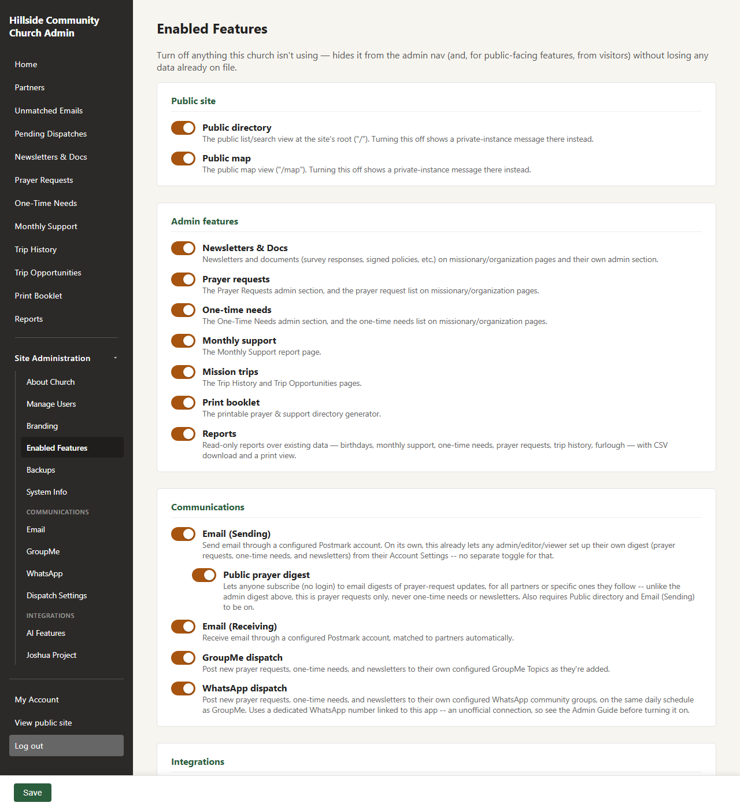
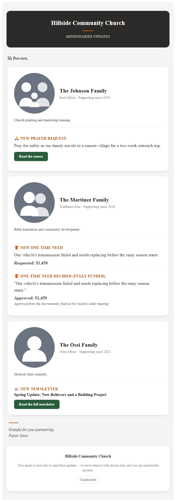
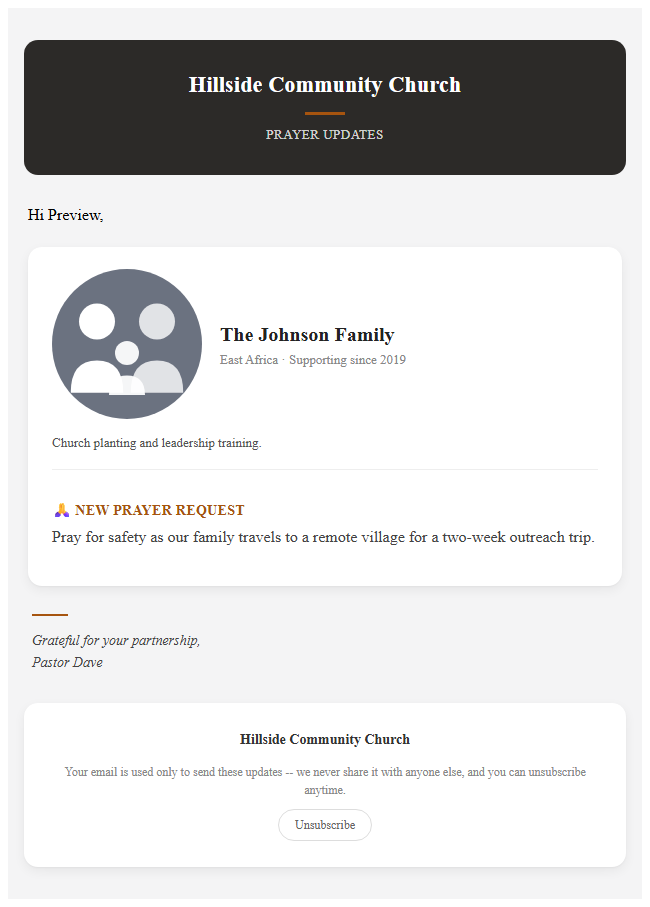
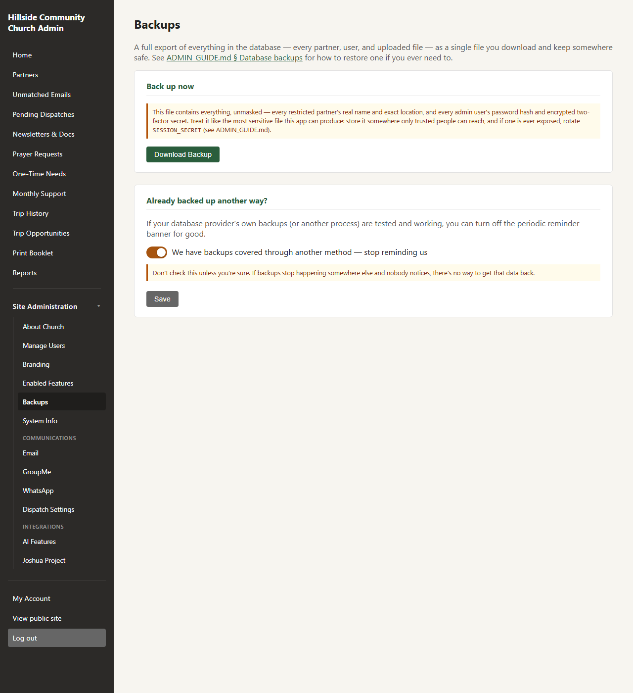

# Admin Guide: Setup & Infrastructure

This is the "getting it running and keeping it running" guide — local
development, environment configuration, authentication setup, deployment,
and ongoing operations. If you're looking for how to actually *use* the
app day-to-day (adding partners, tracking support, exporting the booklet),
see [USER_GUIDE.md](USER_GUIDE.md) instead.

**Contents**

- [Architecture at a glance](#architecture-at-a-glance)
- [Getting your church running (Render)](#getting-your-church-running-render)
- [Environment variables](#environment-variables)
- [Feature toggles](#feature-toggles)
- [Authentication setup](#authentication-setup)
- [File storage](#file-storage)
- [Rate limiting](#rate-limiting)
- [Local development setup](#local-development-setup)
- [Deploying to production](#deploying-to-production)
- [Upgrading a fork](#upgrading-a-fork)
- [Security](#security)
- [Operations](#operations)
- [Troubleshooting](#troubleshooting)

## Architecture at a glance

Two pieces: a Postgres database, and the app itself — one Node/Express
process (`backend/`) that serves both the API and the built React
frontend (`frontend/`, compiled with Vite) from a single origin. There's
no separate frontend host or build pipeline to run in production; the
backend's own deploy is the whole app.

| Piece | What it is |
|---|---|
| **Database** | PostgreSQL, any host — the Render Blueprint deploy (see [Getting your church running](#getting-your-church-running-render) below) provisions its own Render-managed Postgres automatically |
| **App** | Node/Express + Prisma ORM (`backend/`), serving the built React/Vite frontend (`frontend/`) directly — public site + admin dashboard + API, all one deployable origin |

Auth is an `httpOnly`, `Secure`, `SameSite=Lax` session cookie — since
everything is one origin, there's no cross-domain cookie problem to work
around, and a cookie is safer than a token sitting in `localStorage`
(which any JS running on the page — including via an XSS bug — can read;
an `httpOnly` cookie can't be read by JS at all).

## Getting your church running (Render)

**This is the path almost every church should start with.** You don't
need to know how to code, run a database, or use a command-line tool
beyond the one short command below — Render hosts the database and the
app for you, and keeps it updated automatically. If you're planning to
contribute code to this project instead of running it for your own
church, see [Local development setup](#local-development-setup)
further down.

This repo doesn't run a live deployment itself — it's the open-source
upstream that your church's own fork deploys from (see
[Upgrading a fork](#upgrading-a-fork) for how your copy keeps getting
updates later). The deployment itself goes through
[Render](https://render.com), via [`render.yaml`](../render.yaml) at the
repo root — a Blueprint that provisions the web service and Postgres
database (which also holds every uploaded photo, newsletter, and
document — see [File storage](#file-storage) below, nothing extra to
provision) in one step:

1. Make your own copy of this repo, then name it and pick a region:

   ```bash
   npm run name-instance -- your-church-name oregon
   ```

   The name becomes your URL (`your-church-name.onrender.com`); the
   region defaults to `oregon` (valid: `oregon`, `ohio`, `virginia`,
   `frankfurt`, `singapore` — the database and web service must match).
   Render's Blueprint deploy has no picker for either, so both have to
   be set in `render.yaml` before you deploy.

   **Choose the region carefully: it cannot be changed afterwards.**
   Render won't move an existing service, and editing this later just
   makes every Blueprint sync fail silently while the site keeps
   running. Getting it wrong means destroying and recreating both the
   service and the database.
2. Render Dashboard → **New → Blueprint** → pick your fork. The first
   time you do this with a private fork, Render needs its GitHub App
   authorized on that repo (Dashboard → Account Settings → GitHub →
   Configure) — a one-time step.
3. Render prompts for the handful of optional variables `render.yaml`
   marks `sync: false` (`MFA_ISSUER`, etc. — see
   [Environment variables](#environment-variables) below); leave them
   blank to skip those optional features for now. `SESSION_SECRET` and
   `FIELD_ENCRYPTION_KEY` are generated automatically, nothing to enter.
4. Apply the blueprint. Render builds, runs `prisma migrate deploy` as a
   pre-deploy step, and starts the app — no separate migration step to
   remember.
5. Visit your new site and go to `/setup` (or just `/login` — a fresh
   instance redirects there automatically) to create your first admin
   account, right in the browser. No shell access, no
   `DATABASE_URL`/`createAdmin.js` needed — the point of a one-click
   deploy is defeated if the very first login still requires a terminal.

Costs about $13/mo on Render's cheapest paid tiers — free tier exists
but isn't viable for anything long-lived (the web service sleeps after
15min idle, and the database gets deleted after 90 days). Every push to
your fork's `main` redeploys automatically; `.github/workflows/ci.yml`
runs the test suite and a real end-to-end Playwright pass on every PR
and push, independent of deployment.

Once you're up and running, [Environment variables](#environment-variables)
and [Feature toggles](#feature-toggles) below cover what to configure
next, and [Before you deploy a fork, change these](#before-you-deploy-a-fork-change-these)
lists the couple of values worth double-checking before you tell anyone
the URL.

Not using Render, or want to run it yourself on other infrastructure
instead? See [Deploying to production](#deploying-to-production) further
down — same app, same steps in spirit, just without Render's one-click
Blueprint doing the provisioning for you.

## Environment variables

All of these live in `backend/.env` (see `backend/.env.example` for the
full file with inline comments):

| Variable | Required | Notes |
|---|---|---|
| `DATABASE_URL` | Yes | Any Postgres connection string |
| `PORT` | No | Defaults to 4000 |
| `NODE_ENV` | No | `development` or `production` |
| `SESSION_SECRET` | Yes | Signs the session cookie (see [Authentication setup](#authentication-setup)). Generate a long random value, e.g. `openssl rand -base64 48`. See [Rotating SESSION_SECRET](#rotating-session_secret) below |
| `FIELD_ENCRYPTION_KEY` | Recommended | Encrypts two-factor (MFA) secrets at rest. Generate with `npm run generate-secrets`. Without it the app still runs, but MFA enrollment fails. See [Rotating FIELD_ENCRYPTION_KEY](#rotating-field_encryption_key) below |
| `NOMINATIM_CONTACT` | Recommended | Your contact email, sent with geocoding requests per [Nominatim's usage policy](https://operations.osmfoundation.org/policies/nominatim/) |
| `MFA_ISSUER` | No | Name shown in a user's authenticator app when they enroll in MFA; defaults to "Missions Partner Tracker Admin" |
| `APP_BASE_URL` | No | This app's own public URL, no trailing slash — needed for the dispatch queue's own links: the GroupMe newsletter dispatch's link, the email digest's "read the source" / "read the full newsletter" links, and the digest's own unsubscribe link (see [GroupMe dispatch](USER_GUIDE.md#groupme-dispatch-admin-only) and [Pending Dispatches](USER_GUIDE.md#pending-dispatches)). On Render this is picked up automatically from `RENDER_EXTERNAL_URL`; set it explicitly elsewhere. Leave unset and those links just don't appear. |

There's nothing to configure for the frontend separately — it's served by
the backend and always calls `/api` on its own origin.

## Feature toggles

Site Administration → Enabled Features (`/admin/settings/features`) lets an
admin turn off parts of the app a church isn't using — hides the corresponding nav
link/section (and, for the public-site toggles, the site itself) without
losing any data already on file. Enforced server-side too (not just hidden
in the UI): a disabled feature's API routes 404, same as a route that was
never built. Grouped in the UI by what a toggle actually affects: **Public
site** (the two toggles a logged-out visitor can notice at all), **Admin
features** (everything else that only changes a logged-in admin's own
nav), **Communications** (GroupMe and both halves of email, plus Public
prayer digest nested under Email (Sending) since it depends on it), and
**Integrations** (AI Features, Joshua Project).



| Feature | Default | Notes |
|---|---|---|
| Public directory | On | The public list/search view at the site's root (`/`). Off shows a short "this isn't public" page there instead. |
| Public map | On | The public map view (`/map`). Same off-behavior as above. Independent of the directory toggle — a church can run either one alone, or both, or neither; the partner-detail page stays reachable as long as at least one of the two is on. |
| Newsletters & Docs | On | Newsletters and documents (survey responses, signed policies, etc.) on missionary/organization pages and their own admin section. |
| Prayer requests | On | The Prayer Requests admin section, and the prayer request list on missionary/organization pages. |
| One-time needs | On | The One-Time Needs admin section, and the one-time needs list on missionary/organization pages. Only gates the standalone `/api/support-needs` CRUD — a need can still be added via a missionary/organization's own edit form either way (a narrower gap than the other toggles here). |
| Monthly support | On | The Monthly Support report page. |
| Mission trips | On | The Trip History and Trip Opportunities pages. |
| Print booklet | On | The printable prayer & support directory generator. |
| Reports | On | Read-only reports over existing data — birthdays, monthly support, one-time needs, prayer requests, trip history, furlough — with CSV download and a print view. |
| GroupMe dispatch | **Off** | Queues new prayer requests, one-time needs, and newsletters — plus a prayer request's recorded answer and a one-time need's funding decision — for GroupMe, sent out to their own configured Topics on the schedule configured at Site Administration → Dispatch Settings, or via manual send from Pending Dispatches. Configured entirely in the UI (Site Administration → GroupMe) with the admin's own personal access token, not a bot — GroupMe's Bots API has no awareness of Topics. Off by default since it's the one feature here that posts to a third-party service on its own, not just on request. See [USER_GUIDE.md § GroupMe dispatch](USER_GUIDE.md#groupme-dispatch-admin-only). |
| WhatsApp dispatch | **Off** | The same three dispatch types as GroupMe, posted to their own groups inside one WhatsApp community, on the same daily schedule and content-type mutes as GroupMe (a church can run either or both). Configured entirely in the UI (Site Administration → WhatsApp): link a **dedicated** phone number by scanning a QR code, pick the community, then a group per dispatch type. Off by default because it's an **unofficial** connection — see [Dispatch: WhatsApp](#dispatch-whatsapp) below before turning it on. See [USER_GUIDE.md § WhatsApp dispatch](USER_GUIDE.md#whatsapp-dispatch-admin-only). |
| Joshua Project stats | **Off** | Shows country-level unreached-people-group statistics on a partner's page (public and admin). Requires an API key, set at Site Administration → Joshua Project ([free key](https://joshuaproject.net/api/request)). The Country Code (FIPS) field on Serving Location only appears once this is on — turning it on after partners already exist means going back into each one's Serving Location to enter the code manually or re-trigger the auto-lookup (see [USER_GUIDE.md § Editing a partner](USER_GUIDE.md#editing-a-partner)). |
| AI Features | **Off** | Adds a "Scan for requests" button on each newsletter/document that's PDF, JPEG, PNG, or `.eml` (Word/Excel aren't supported). Sends that one file to Claude (Anthropic's API) to look for prayer requests and one-time financial needs, then shows them for review — nothing is added until you explicitly accept a suggestion. Requires an API key, set at Site Administration → AI Features ([get one at console.anthropic.com](https://console.anthropic.com/settings/keys), pay-per-scan, a few cents/month at typical volume). Off by default even once the key is configured, since it's the one feature here that sends data to a third party. |
| Email (Sending) | **Off** | Enables outbound email through a configured [Postmark](https://postmarkapp.com) account, set at Site Administration → Email. Today's only sender is the batched dispatch digest (see [§ Email (Postmark)](#email-postmark) below), plus Send Test Email on that same settings page. Independent of Email (Receiving) below — a church can turn on either, both, or neither. |
| Email (Receiving) | **Off** | Lets partners email newsletter updates straight into this app via a Postmark inbound webhook, auto-filed to the matching partner or queued in Unmatched Emails otherwise. Set up on the same Site Administration → Email page as Sending, independently toggled. See [§ Email (Postmark)](#email-postmark) below. |
| Public prayer digest | **Off** | Lets anyone subscribe (no login) to email digests of prayer-request updates, from the public **Subscribe** page (`/subscribe`) or from a single partner's own page — for all partners or just the ones they pick. Also requires Public directory and Email (Sending) to be on — shown nested under Email (Sending) on this page, and its checkbox can't be turned on until that one is. See [§ Dispatch: GroupMe, the admin digest, and the public digest](#dispatch-groupme-the-admin-digest-and-the-public-digest) below. |

The registry backing this list lives in `backend/src/utils/features.js` —
adding a new toggle later is a one-line entry there plus a `requireFeature("key")`
check on the relevant route(s), not a database migration.

All of this lives under **Site Administration**, an expandable group in
the admin sidebar itself (not a separate page with its own tab bar) —
click it to reveal About Church, Manage Users, Branding, Enabled
Features, and Backups, then two further sub-groups shown only once
their features are on: **Communications** (Email, GroupMe, WhatsApp,
Dispatch Settings, Email Dispatch Subscribers) and **Integrations** (AI
Features, Joshua Project). User
Management moved here from its own top-level nav link. Adding a new
settings category later is a new entry in `buildSiteAdminLinks()`
(`components/admin/AdminSidebar.jsx`) plus a new child route in
`main.jsx`, not a restructure.

## Authentication setup

Accounts are email and password, optionally with TOTP two-factor. There is
nothing to configure beyond your first admin account, created at `/setup`
on a fresh deploy or with `createAdmin.js` — see
[Getting your church running](#getting-your-church-running-render) above.

This app deliberately has no single sign-on. An earlier version supported
OIDC, but it auto-provisioned an account for anyone who could authenticate
at the configured identity provider, and in this app **any account can read
every partner's full record** — including restricted partners' exact
locations and contact details. Handing that out on the strength of "has a
Google account" was the wrong trade for the data involved. Controlling who
gets an account is the entire security boundary here, so accounts are
created deliberately, by an admin.

A few things worth knowing operationally:
- `SESSION_SECRET` is what signs the session cookie — see
  [Rotating SESSION_SECRET](#rotating-session_secret) below before you
  ever need to do this in a hurry.
- `FIELD_ENCRYPTION_KEY` encrypts two-factor (MFA) secrets in
  the database — see
  [Rotating FIELD_ENCRYPTION_KEY](#rotating-field_encryption_key) below.
- MFA (TOTP) is opt-in and self-service per user, or an admin can force
  it on a specific account. See
  [USER_GUIDE.md § Your account settings](USER_GUIDE.md#your-account-settings)
  for the user-facing flow.

For the app's role model itself (`viewer`/`editor`/`admin`), see
[USER_GUIDE.md § Understanding your role](USER_GUIDE.md#understanding-your-role).

## File storage

Photos, logos, newsletter PDFs, and other partner documents are stored
directly in the database — a `bytes` column right on the `Photo` and
`PartnerFile` rows (see the `PartnerFile` model comment in
`backend/prisma/schema.prisma` for the full reasoning). There's no
separate object storage service to provision, configure, or hold
credentials for; the database backup you're already taking covers files
too.

Public images (missionary/org photos, the church logo) are served
unauthenticated at `GET /api/photos/:id/raw` and
`GET /api/public/settings/logo/raw` (`backend/src/routes/photos.js`,
`publicSettings.js`) — the same access model as the old public-read S3
prefixes, just same-origin instead of a different bucket domain. Private
files (newsletters, documents) stream from
`GET /api/newsletters/:id/download` / `GET /api/documents/:id/download`,
gated by the same session-cookie auth as every other admin route — no
signed URLs to generate or expire.

Upload limits are capped at 10MB per file (`routes/newsletters.js`,
`routes/documents.js`; missionary/org photos and the church logo were
already capped at 5MB) — the point past which the usual Postgres guidance
shifts from "just use the database" to "use object storage instead."
Fine for one church's worth of files; if a particular fork's usage
outgrows this, swapping a `bytes` column for a URL column pointing at an
external store is a contained, well-understood migration, not an
architecture rewrite.

## Rate limiting

A few endpoints are rate-limited per IP (`backend/src/server.js`), mainly
to blunt scripted abuse now that the public site is unauthenticated by
design:

| Endpoint(s) | Limit |
|---|---|
| `/api/auth/login` | 20 requests / 15 min |
| `/api/auth/setup` | 20 requests / 15 min |
| `/api/auth/mfa/login-verify` | 10 requests / 15 min |
| `/api/auth/mfa/verify-setup`, `/api/auth/mfa/disable`, `/api/auth/change-password` | 10 requests / 15 min — these sit behind a session, but a session isn't a guess limiter, and each one checks a short code or the current password |
| `/api/public/*` (directory, map, country stats, public settings) | 120 requests / min |

These aren't env-configurable — if your instance needs different limits
(e.g. a very high-traffic public site), edit the `rateLimit(...)` calls in
`server.js` directly. A legitimate user hitting one during normal use gets
a `429` response; that's a sign the limit needs raising for your traffic,
not a bug to work around.

## Local development setup

**This section is for contributing code to the project itself.** If you
just want to run this app for your own church, you don't need any of
this — see [Getting your church running](#getting-your-church-running-render)
above instead.

1. **Prerequisites**: Node.js 20.19+ or 22.12+ (required by Vite 8), and a
   Postgres database (local, Docker, or a free cloud instance like
   [Neon](https://neon.tech) or [Supabase](https://supabase.com)). Photos,
   newsletters, and documents are stored in that same database — no
   separate file storage to set up, see [File storage](#file-storage)
   above.
2. **Backend**:
   ```bash
   cd backend
   cp .env.example .env       # fill in DATABASE_URL, SESSION_SECRET, etc. — see reference above
   npm install
   npm run prisma:migrate     # creates tables
   npm run seed                # optional: ~35 fake partners for demoing the UI
   node prisma/createAdmin.js you@yourchurch.org "SomeStrongPassword!"
   npm run dev                  # http://localhost:4000
   ```
3. **Frontend**:
   ```bash
   cd frontend
   npm install
   npm run dev                  # http://localhost:5173
   ```
   No frontend `.env` needed locally — Vite proxies `/api` to
   `http://localhost:4000` automatically (see `frontend/vite.config.js`).
4. Visit `http://localhost:5173/login` and sign in with the account you
   just created.

### Building for production

```bash
cd frontend
npm run build      # writes into backend/public — see vite.config.js
```
The build writes directly into `backend/public` (not `frontend/dist`) so
the backend can serve it as a plain sibling directory — see
`backend/src/server.js`'s static-file serving. No env var to set: the
frontend always calls `/api` on its own origin, since the backend is
always what serves it.

The backend itself has no build step beyond that — `npm run start` runs
`src/server.js` directly, and it'll serve whatever's currently in
`backend/public`. Deploying the app means deploying `backend/` *after*
running the frontend build, so `backend/public` is populated — see
[Deploying to production](#deploying-to-production) below.

### Running tests

```bash
cd backend
npm test
```
Covers the public/restricted data-masking rules and the auth middleware —
see [CONTRIBUTING.md § Running tests](CONTRIBUTING.md#running-tests) for
what is and isn't covered yet. There's no frontend test suite currently.

## Deploying to production

**Already using Render?** See
[Getting your church running](#getting-your-church-running-render) above
— it covers the one-click path end to end. This section is for running
the app yourself on other infrastructure instead.

The app is two pieces: a Postgres database, and the app itself — one
Node/Express process that serves both the API and the built frontend.
There's no separate frontend host to configure or keep in sync; deploying
the backend *is* deploying the whole app.

### Deploying anywhere else

Nothing about this app is Render-specific. Some other options that work
well for a small church team:

| Piece | Options |
|---|---|
| Database | [Neon](https://neon.tech), [Supabase](https://supabase.com), [Railway](https://railway.app), or any managed/self-hosted Postgres |
| App | [Railway](https://railway.app), [Fly.io](https://fly.io), a plain VPS running `npm run start` behind nginx + `pm2` — anything that can run a long-lived Node process. There's no Dockerfile in this repo, so a platform that builds straight from a Node buildpack needs the least setup. Whatever you use needs to run the frontend build (`cd frontend && npm run build`) *before* starting the backend, so `backend/public` is populated. |

Wherever you land, the deployment steps are the same shape regardless of
provider:

1. Provision Postgres, run `npx prisma migrate deploy` against it (from
   `backend/`, with `DATABASE_URL` set).
2. Build the frontend (`cd frontend && npm run build`) — this writes into
   `backend/public`, so do this *before* the next step.
3. Deploy the backend (including the now-populated `backend/public`) with
   every variable from the
   [Environment variables table](#environment-variables) set as that
   platform's environment/config vars — never commit `.env`.
4. Visit your new site and go to `/setup` to create your first admin
   account right in the browser — or, if you'd rather do it from a
   shell with `DATABASE_URL` set, `node prisma/createAdmin.js
   you@yourchurch.org "SomeStrongPassword!"` does the same thing.
5. Use HTTPS everywhere in production — required for the session
   cookie's `Secure` flag to actually work, and just generally expected
   for a site handling admin logins.

### Before you deploy a fork, change these

A few things default to placeholder or project-specific values and should
be treated as "must set," not "nice to set":
- `SESSION_SECRET` — generate your own; never reuse the example value or share it across environments.
- `NOMINATIM_CONTACT` — your own email, so misbehaving geocoding traffic isn't attributed to someone else.

### If you're running a private fork alongside this public repo

Some churches keep a private fork for their real production deployment
(with real deploy credentials, connected to their own Render workspace, etc.) while pulling updates from
this public repo as upstream. If that's your setup:
- Keep anything environment-specific (real resource names, deploy
  credentials) in your platform's config/Secrets, **never** hardcoded
  into a file that gets merged from upstream — otherwise every sync
  either overwrites your real values with this repo's placeholders, or
  creates a merge conflict on every pull.
- The two repos need *shared git history* for `git merge upstream/main`
  to work as a normal, low-conflict merge instead of hitting "refusing to
  merge unrelated histories." If your fork predates this repo's public
  history (e.g. it was split off by copying files rather than filtering
  git history), you'll likely need a one-time reconciliation merge
  (`git merge upstream/main --allow-unrelated-histories`, resolving
  conflicts file-by-file) before ongoing syncs become simple merges.
- After merging in an update, always run `npm install` and your test
  suite/build before deploying — a clean git merge doesn't guarantee the
  result actually runs.

### Demo mode

Optional, and only relevant if you want to stand up a public demo
instance — a deployment anyone can visit and actually try the admin
dashboard on, running fake seeded data that resets on a schedule so
nothing anyone does there is permanent.

Set three env vars (see `backend/.env.example`):
- `DEMO_ADMIN_EMAIL` / `DEMO_ADMIN_PASSWORD` — the login you publish for
  visitors to use.
- `DEMO_RESET_TOKEN` — a random secret (`openssl rand -base64 32`). This
  is what makes `POST /api/demo/reset` exist at all — the route isn't
  mounted unless this is set, so a normal deployment with real data has
  no trace of this feature. Leave all three unset for a real deployment.

Optionally, `SEED_MISSIONARY_COUNT`/`SEED_ORGANIZATION_COUNT` control how
much fake data each reset generates (default 35/12, same as local
`npm run seed`) — a public demo might want more to look fuller.

Also optionally, `PEXELS_API_KEY` gets real stock photos instead of
generated silhouette avatars — each seeded missionary gets a photo
matched to their household size (single adult, couple, family with kids,
larger family), and each organization gets a logo-style photo. Free key
at [pexels.com/api](https://www.pexels.com/api/); see
`backend/.env.example` for details. Leave it unset and seeding still
works exactly as before, just with silhouettes.

Calling `POST /api/demo/reset` with `Authorization: Bearer <DEMO_RESET_TOKEN>`
(or running `npm run demo:reset` locally/on the server directly) wipes the
database (`npx prisma migrate reset --force`) — which, since photos,
newsletters, and documents live in that same database, also clears every
uploaded file in one step (a prior cycle's seeded photos, a demo
visitor's newsletter, a custom logo someone set) — then reseeds
(`backend/prisma/seed.js`), recreates the demo login
(`backend/prisma/createAdmin.js`), and sets Church Settings to a
demo-branded name/tagline/about-text that tells visitors it's a live
demo and states the login credentials — reusing the existing
white-labeling mechanism, no frontend changes needed. See
`backend/scripts/reset-demo-data.js` for the exact sequence.

To actually reset on a schedule, add a scheduled job **in your fork's own
repo** (not this one — scheduling is deployment-specific) that calls the
route periodically, e.g. a GitHub Actions workflow with a `schedule:`
cron trigger doing:
```bash
curl -X POST https://your-demo-domain/api/demo/reset \
  -H "Authorization: Bearer ${{ secrets.DEMO_RESET_TOKEN }}"
```
No additional infrastructure needed — GitHub Actions is free for this
kind of lightweight scheduled job, and you don't need it for deploys
themselves (Render redeploys automatically on push).

**This wipes the entire database.** Never set `DEMO_RESET_TOKEN` (or run
`npm run demo:reset`) against a deployment holding real partner data.

## Upgrading a fork

If you forked this repo, see [UPGRADING.md](UPGRADING.md) for the full
process — it's a normal `git merge` from an `upstream` remote, and stays
conflict-free as long as your church's customization lives in Church
Settings/env vars rather than hand-edited code (see
[CONTRIBUTING.md](CONTRIBUTING.md) for why). Check
[CHANGELOG.md](CHANGELOG.md) for what changed before upgrading — entries
flagged as breaking (`MAJOR` version bump) usually mean a required
migration or a new required env var.

## Security

### Who can see what

**Authentication is the confidentiality boundary. Roles only govern
writes.**

Any account that can log in can read every partner's full record: exact
addresses and GPS coordinates, family members' contact details and
birthdays, emergency contacts, uploaded documents, and the real name and
photograph of partners marked restricted-access. `viewer` restricts what
someone can *change*, not what they can see. There is no reduced read view
for lower roles, and adding one is a deliberate non-goal.

The consequence worth internalising: **controlling who gets an account is
the entire security model.** There is no second line of defence behind the
login. In practice that means:

- Create accounts deliberately, one at a time, for people you'd trust with
  the information. Don't create one "so they can have a look".
- Deactivate promptly when someone leaves. Deactivating or deleting takes
  effect on their next request — sessions are re-checked against the
  database rather than trusted for their full lifetime.
- Require two-factor for accounts that can write. A password alone is one
  phishing email away from everything above.
- Anyone who only needs what's public should use the public site, which
  runs every record through a masking serializer that hides restricted
  partners' names, photos and precise locations. They don't need an
  account at all.

If you need staff who can see *some* partners but not others, this app
can't express that, and pretending otherwise with roles would be worse
than saying so plainly. The Pending Dispatches page's own held-row
text (see [§ Restricted-partner dispatch
review](#restricted-partner-dispatch-review)) follows this same
rule — it's not role-gated, since `GET /api/prayer-requests` and `GET
/api/support-needs` already show that same text to any logged-in role
with no masking at all; hiding it specifically in one list would be
exactly the kind of reduced read view this section rules out.

### Rotating SESSION_SECRET

This signs the session cookie — rotating it (generate a new value, e.g.
`openssl rand -base64 48`, and update it wherever your backend gets its
env vars) **instantly invalidates every currently-issued session token**,
logging everyone out. That's the correct, expected behavior if you ever
suspect the value has leaked — do it, then have everyone log back in.
There's no partial/soft rotation; it's all-or-nothing by design.

### Rotating FIELD_ENCRYPTION_KEY

This encrypts two-factor (MFA) secrets at rest
(`backend/src/utils/crypto.js`). Unlike `SESSION_SECRET`, rotating it is
**not** a drop-in swap — every value already encrypted with the old key
becomes unreadable the moment you change it, which breaks two-factor
logins until re-enrolled. If you need to rotate it: decrypt and
re-encrypt every affected row under the old key before switching (there's
no built-in script for this since it's rare enough not to warrant one —
MFA-enabled users can instead have their MFA reset from Manage Users and
re-enroll). Only rotate this if you suspect it's actually leaked;
otherwise leave it alone indefinitely.

### Restricted-country masking policy

Every missionary/organization record has an `isRestricted` flag —
enabling it masks the name (missionaries only), precise GPS, and overview
on the public site. Review `backend/src/utils/maskData.js` as a team
periodically: the defaults are reasonable, but you know which fields are
genuinely safe to show for your specific restricted-access partners. This
file is the single place to adjust that policy. Full explanation of what
gets masked: [USER_GUIDE.md § Understanding restricted-access partners](USER_GUIDE.md#understanding-restricted-access-partners).

## Operations

### Email (Postmark)

Sending and receiving email (Site Administration → Email) both go
through [Postmark](https://postmarkapp.com), a dedicated transactional
email provider — not SMTP against this church's own Gmail/Microsoft
mailbox, and not this app sending/polling mail directly. It's the option
that gives the most reliable coverage across churches regardless of who
hosts their email, and its free tier is plenty for many churches'
volume.

Sending and receiving are two **independent toggles** in Enabled
Features — a church can turn on just one, the other, or both. They share
one settings page because it's one Postmark account either way, not
because they depend on each other.

**Sending.** Postmark's own HTTP API needs only a single server token —
no OAuth app to register and maintain. Setup: create a free Postmark
account, verify a sending domain (adds SPF/DKIM records to that
domain's DNS — a one-time step with whoever manages it), then paste the
**Server API Token** and a
**From Address** on that domain into Site Administration → Email. **Send
Test Email** confirms it actually works before anything depends on it.
Free tier is 100 emails/month with no card required; a small church's
outbound volume plausibly fits inside that indefinitely.

**Receiving.** Lets missionary and organization partners email updates
straight into this app instead of someone forwarding or re-uploading
them by hand. Postmark's inbound stream pushes a webhook to this app the
moment an email arrives at the address you configure — no mailbox to
provision, no scheduler or cron job checking an inbox on a timer. The
webhook includes the entire raw email (headers, body, attachments) in
one request, which this app stores as a `.eml` file, exactly like a
manually-uploaded newsletter. If the sender's address matches exactly
one partner — either that partner's own Contact Email (organizations) or
any of their household adults' email addresses (missionaries) — it's
filed as a Newsletter automatically, scannable by AI Features
like any other. If zero partners match, or more than one does, it lands
in the **Unmatched Emails** queue instead of guessing, where any
logged-in admin or editor can view the raw email and assign it to the
right partner (or an admin can discard it). Setup:

1. Create a free Postmark account (or reuse the one from Sending above —
   the same server can run both an outbound and an inbound stream).
2. On your server's **Default Inbound Stream** → Settings tab, pick a
   dedicated subdomain for inbound mail (e.g. `updates.yourchurch.org`)
   under **Inbound domain forwarding** — **never your church's real
   inbox**. Partners send to this address, not to a real mailbox anyone
   reads.
3. Check **Include raw email content in JSON payload** — without this,
   Postmark's webhook omits the field this app reads, and every inbound
   email fails.
4. Set the **Inbound webhook** URL to
   `https://<username>:<password>@yourapp.com/api/inbound-email/postmark`,
   using a username/password you choose yourself — paste the same two
   values into Site Administration → Email. Postmark sends them as HTTP
   Basic Auth on every request; this app verifies them with a
   constant-time comparison before accepting anything, and a wrong
   password gets a plain 401, never a hint about what's missing.
5. Turn **Email (Receiving)** on at Site Administration → Enabled
   Features once it's configured — independent of whether **Email
   (Sending)** is also on.

**Data exposure**, same honesty this guide already applies to GroupMe and
AI Features: mail sent or received this way passes through
Postmark's infrastructure in transit. Postmark's data centers carry SOC
2 Type II / ISO 27017/27018 / PCI DSS Level 1 compliance, with TLS in
transit and encryption at rest; Postmark itself (distinct from its data
centers) hasn't undergone its own independent SOC audit. Postmark
retains inbound message content for **45 days by default** before it's
purged from their side; this app's own copy (the stored `.eml`, whether
filed as a Newsletter or still sitting in the Unmatched Emails queue) is
what persists afterward — a church shouldn't rely on Postmark itself as
a second copy past that window.

### Dispatch: WhatsApp

WhatsApp has no bot API for existing groups and communities. The official
WhatsApp Business API only supports groups it creates itself, so this
feature instead links a phone number to the app as a **linked device** —
the same mechanism as WhatsApp Web — using the open-source
[Baileys](https://github.com/WhiskeySockets/Baileys) library, wrapped in
[baileys-antiban](https://github.com/kobie3717/baileys-antiban). Things to
know before turning it on:

- **It's unofficial, and WhatsApp can ban the number.** Use a **dedicated
  number** (a prepaid SIM or a second line that can receive WhatsApp's
  one-time verification), never anyone's personal WhatsApp. Keep the
  volume low — a handful of messages a day is what it's built for. The
  anti-ban layer spaces sends out like a person would, blocks identical
  repeats, and **pauses sending automatically** if the number's ban risk
  climbs (the Site Administration → WhatsApp page shows a warning, and
  anything not sent simply stays queued for the next daily send). It
  reduces the risk; it can't remove it.
- **The number must be a member** of the community and of every group you
  map (and an admin of any group where only admins can post).
- **Announcements fallback.** Every WhatsApp community has a built-in
  Announcements group, detected automatically the moment you pick the
  community (no picker for it — the WhatsApp settings page just shows
  which one it found). A dispatch type with no group of its own mapped
  posts there instead; only with neither set does it not go out over
  WhatsApp. GroupMe's main conversation plays the same role for
  GroupMe — each channel has its own independent fallback target, not
  a shared one.
- **What's stored.** The linked session lives in the database, encrypted
  with `FIELD_ENCRYPTION_KEY` (the same protection as the GroupMe token),
  and is never sent to the browser. It is deliberately **not** in
  backups: after restoring a backup onto a new instance, the app notices
  the missing session and asks you to link again. Losing
  `FIELD_ENCRYPTION_KEY` has the same effect. Unlinking from the app (or
  removing the device in WhatsApp) wipes it. Message text is never
  written to the logs.
- **Data exposure**, same honesty as GroupMe: what you post travels
  through WhatsApp (end-to-end encrypted between the linked number and the
  group's members, as with any WhatsApp message) and is readable by every
  member of the group it posts to. A restricted partner's items are masked
  and held for review exactly as they are for GroupMe.
- **Hosting.** The connection runs inside the existing web service — no
  extra Render service. It needs an always-on instance (the `starter`
  plan in `render.yaml` is; free web services sleep and would drop the
  connection). Only one copy of the app may hold the session at a time:
  during a deploy the new instance waits (a minute or two) for the old one
  to let go, handled automatically with a database lock.
- **Schedule and message size.** WhatsApp sends once a day, at an
  admin-set hour, with three independent content-type mutes (Prayer
  Requests / One-Time Needs / Newsletters) — both configured on Site
  Administration → Dispatch Settings. GroupMe and WhatsApp are both
  chat-style, near-real-time channels, which is why they're scheduled
  on that one shared daily-hour field and the same three mutes rather
  than each getting its own — not because WhatsApp borrows GroupMe's
  settings. Each channel still tracks its own sent state with its own
  dedupe cursor, so one being down, muted, or off never blocks or
  double-stamps the other. Related items going to the same group are
  combined into one message (kept under 4,000 characters); a single
  item longer than that is split into consecutive messages rather than
  cut off.

### Dispatch: GroupMe, the admin digest, and the public digest

Every event a partner generates — a prayer request created or
answered, a one-time need created or decided, a newsletter arriving —
is recorded once, in a shared `DispatchRecord` table, with exactly one
exception: a restricted partner's event is only recorded at all if
**Restricted partners** (below) is on. Everything else about how it
actually reaches someone is a question of *delivery*, answered
identically by one shared rule regardless of channel: GroupMe, the
admin digest, and the public digest each independently decide, at the
moment they're about to send, whether a given recorded event belongs
in their send. A recorded event clears (deletes) once every channel
that could ever have delivered it either has, or permanently can't
(a muted content type or an off feature counts as "permanently can't"
the moment it's evaluated that way — turning it back on later only
affects events recorded after that point, never a retroactive
backlog).

- **GroupMe** — full item text (never summarized), packed into as few
  messages as fit under GroupMe's 1,000-character limit, to each
  type's own configured Topic. Fires once a day, at an admin-set hour
  shared with WhatsApp (below) — a single daily batch, not a
  weekly/monthly tier, since GroupMe is a near-real-time chat channel,
  not a periodic email. Three content-type mutes (Prayer Requests /
  One-Time Needs / Newsletters), also shared with WhatsApp, let a
  church turn off any one type for both chat channels at once without
  affecting the admin or public digest at all.
- **WhatsApp** — the same three item types, posted to their own group
  inside one WhatsApp community (or the community's Announcements
  group, for a type with no group mapped). GroupMe and WhatsApp share
  one daily-hour field and the same three content-type mutes
  specifically because both are chat-style, near-real-time channels —
  not because either one depends on or copies the other's settings.
  Each still has its own independent on/off state, its own
  connection/target configuration, and its own delivery and sent-state
  tracking: turning one off, muting it, or its service being
  unreachable never affects the other.
- **Admin digest** — one HTML email per user who's picked a cadence
  (self-service from their own Account Settings), grouped by partner,
  always including every content type it's allowed to (no mute
  toggle — it's a periodic batched email, not a live feed). A request/
  need sourced from a newsletter nests under that newsletter's own
  block instead of linking to it separately.
- **Public digest** — the same cadence/scope choice, open to anyone
  with no login (see the next section), but structurally
  **prayer-requests only** — never a one-time need, never a newsletter,
  never a link back to a source document. That's enforced by the
  renderer's own function signature having no parameter capable of
  carrying a source link at all, not just a check that happens to leave
  one out.

Same batch of events, rendered for each audience, side by side — notice
the admin version's source link, decision amount, and newsletter title,
all structurally absent from the public one:

| Admin digest | Public digest |
| --- | --- |
|  |  |

Both email digests share one subject-line template, signature, and
layout choice (Classic — text only, or Snapshot — adds each partner's
photo/field/overview), all admin-configurable on the same Dispatch
Settings page. Full walkthrough of each control: [USER_GUIDE.md § Email Dispatch
Customization](USER_GUIDE.md#email-dispatch-customization).

A restricted-access partner's content is masked on every channel —
name reduced to initials, photo to a silhouette, no source link —
computed fresh from the partner's *current* `isRestricted` value at
send time, not from whatever it was when the event was first recorded,
so flipping that flag afterward still takes effect. A restricted
partner's prayer request or one-time need additionally can't send **at
all**, on any channel — GroupMe, WhatsApp, or either digest — until an
admin has reviewed it — see
[§ Restricted-partner dispatch review](#restricted-partner-dispatch-review)
below. Masking itself is unconditional and unaffected by review state
either way.

**Schedules.** The admin and public digests share three cadence tiers
— biweekly, monthly, or quarterly — each admin and public subscriber
picks for themselves; the church sets the actual day/time those tiers
fire on the Dispatch Settings page. GroupMe and WhatsApp's shared
daily hour is a completely separate, independent setting on the same
page — a church can run the chat channels and the email tiers on
entirely different schedules.
Both are checked once a minute by their own in-process
[`node-cron`](https://www.npmjs.com/package/node-cron) jobs started in
`server.js`, not a separate Render Cron Job resource and not an
external scheduler — a deliberate fit for this app's actual scale:
`render.yaml` provisions exactly one web service instance, so there's
no multi-instance double-fire risk to guard against. If this app is
ever scaled to 2+ instances, that risk returns and needs addressing
then — not a concern worth building for today. A deploy landing in the
exact scheduled minute just skips that one occurrence, picking it up
at the next.

Those schedules are interpreted in this church's own configured
timezone (Site Administration → About Church → **Timezone**), not the
server's. Every "send at hour N" field in this app depends on that
setting — without it, "9" would mean 9am on the server (effectively
UTC on Render, never a church's own local time). Changing the timezone
takes effect on the next restart/deploy, not instantly.

### Urgent dispatch

An admin or editor can mark a prayer request or one-time need **urgent**
at the moment they create it (there's no equivalent for a newsletter —
nothing creates one through a form a human fills out in the moment).
Checking the box and saving shows a confirmation naming the real number
of admins and public subscribers about to be notified, then — once
confirmed — sends immediately to every dispatch channel this
church has enabled, bypassing each recipient's own chosen schedule
entirely.

"Bypass the schedule" is the *only* thing urgent changes. It still
calls the exact same delivery rule every scheduled send does: a
restricted partner's urgent item still waits on human review before it
sends anywhere, a muted GroupMe content type still suppresses an
urgent GroupMe post, and an urgent one-time need still never reaches
the public digest (structurally prayer-only, same as always). A
subscriber's chosen cadence describes their *routine* updates, not a
hard ceiling on everything they might receive — both cadence pickers
disclose this at the point someone picks a tier.

For a restricted partner specifically, a second checkbox — **Review
and approve now** — appears alongside **Mark as urgent**, admin/editor
only. Checking it confirms, at creation time, that the exact text just
typed is safe to send verbatim, and clears the review hold right then
instead of requiring a separate visit to Pending Dispatches
afterward. It's a shortcut for the same review step described in
[§ Restricted-partner dispatch
review](#restricted-partner-dispatch-review), not a send of its
own: checking it alone doesn't push anything out anywhere. Reaching
any channel still depends on that channel's own schedule firing next,
or on also checking **Mark as urgent** for an immediate send.

### Public prayer digest & the scoped-digest schedule

Anyone, no login required, can subscribe to email updates on prayer
requests — either every partner, several of them, or just one, all from
a single dedicated **Subscribe** page (`/subscribe`), or from a "follow
this partner" form on that partner's own public page (which also points
back to the Subscribe page, for anyone who wants more than just that one
partner). This rides the exact same `DispatchRecord` rows and the same
restricted-partner masking and review gate the previous section
describes — a public digest is **prayer-requests only** by construction,
same as stated above.

A subscriber confirms by email first (double opt-in — nothing sends to
an unconfirmed address) and picks biweekly, monthly, or quarterly; the
same cadence + all-partners-or-specific-partners choice is also
available to any admin/editor/viewer from their own [Account
Settings](#your-account-settings) — unlike the public digest, an
admin's own digest still includes one-time needs and newsletters, same
as always. Turned on at Site Administration → Enabled Features
(**Public prayer digest**, off by default); also needs Public
directory and Email (Sending) on, since there's no public site to
follow a partner from without the first and no way to send a
confirmation without the second. Turning **Public prayer digest** off
again stops delivery to already-confirmed subscribers immediately, not
just new signups.

An **Email Dispatch Subscribers** section on the same Dispatch Settings page
(visible whenever the public digest is on) shows how many admins and
public visitors are subscribed — counts only, never an email address.

Because this is the only place the app collects an email address from
an anonymous member of the public, both subscribe forms (and the
confirm/unsubscribe pages reached from the email itself) carry a short,
plain statement of what actually happens: the address is used only to
send these updates, never shared, and unsubscribing is always
one click. That's a real commitment, not boilerplate — nothing in this
feature sends a subscriber's address anywhere except Postmark for
delivery (same as every other email this app sends, and always one
individually-addressed send per recipient — Postmark's batch send
endpoint reduces API round-trips, never recipient count, and carries no
Cc/Bcc of any kind), and the admin summary section above never exposes
raw addresses. Worth keeping in mind before adding anything (analytics,
a third-party integration, an export) that would make that statement
stop being true.

### Restricted-partner dispatch review

A restricted partner's prayer request/one-time need (new, answered, or
decided) is recorded the same as anyone else's, but can't actually send
on any channel — not GroupMe, not WhatsApp, not either digest, not an
urgent dispatch — until an admin reviews it. This is on top of the structural
masking above, which applies regardless: it's about whether the
request/need **text itself** is safe to send verbatim, something only a
human reading the real content can judge. Newsletters aren't affected —
a restricted partner's newsletter dispatch is already fully
suppressed, nothing to review.

On the Pending Dispatches page, a held item shows an amber
**Awaiting review** badge, and the row itself already shows the real
(unmasked) text — not the generic placeholder — regardless of who's
looking; that text was never actually protected by hiding it here, since
`GET /api/prayer-requests`/`GET /api/support-needs` already show it to
any logged-in role with no masking at all (see [§ Who can see
what](#who-can-see-what)). Only admin/editor can actually clear a hold,
which still requires a confirm dialog repeating the exact text before
it's accepted, one of two ways:

- **Approve** — a one-click path for text that's already fine as-is.
  Shows the real text in the confirmation prompt, nothing to edit.
- **Edit** — opens the same reveal-and-edit view available on any
  queued item (see [USER_GUIDE.md § Pending
  Dispatches](USER_GUIDE.md#pending-dispatches)), but for a held
  item, saving carries the same confirmation and also clears the hold —
  the button reads **Save and Approve** rather than plain **Save** to
  make that consequence explicit.

Either path writes the admin's reviewed text as the authoritative
content going forward (overriding whatever would otherwise display),
and the item becomes eligible for the next send on any channel, same
as any other recorded event. Editing again later overwrites the
previously reviewed text.

A church that would rather not run a review step at all — fully
automated, nobody checking a queue — can leave **Restricted partners**
off on the Dispatch Settings page (the default). With it off, a restricted
partner's events are never recorded in the first place, for any type;
there's nothing to hold and nothing to review, since there's nothing
recorded. Turning it on takes on the review responsibility above in
exchange for restricted partners' events reaching every channel like
anyone else's.

### Database backups

Your Postgres provider's own backups are still the first line of defense
— most managed providers, including Neon, offer point-in-time recovery
out of the box. Confirm your provider's backup retention matches how much
data loss your church would tolerate before you're relying on real
partner data.

On top of that, **Site Administration → Backups** gives any admin a
self-service way to download a full backup on demand — every partner,
user, and uploaded file, as a single gzipped file — without connecting a
storage provider or setting anything up first. Nothing about this is
scheduled or automatic, and nothing is kept server-side: downloading is
the only copy that exists, so store it somewhere safe immediately (a
password manager's file storage, an encrypted drive — somewhere only
trusted people can reach).



**This file is the most sensitive thing this app can produce.** It
contains unmasked data for every partner, including restricted ones
(real names, exact locations), and every user's password hash and
encrypted two-factor secret. Treat it accordingly, and if one is ever
exposed, rotate [`SESSION_SECRET`](#rotating-session_secret) immediately.

A periodic banner also reminds every admin to confirm their provider's
own backup settings (dismissible for ~30 days at a time, per browser). If
your provider's backups are already tested and working, the same Backups
page has an explicit, permanent opt-out for that reminder — it requires
deliberately checking a box and saving, not a casual dismiss, since
turning it off removes the only in-app nudge that backups are happening
at all.

#### Restoring a backup

Restoring is deliberately **CLI-only** — there's no "restore" button in
the UI. An untested restore path makes the backup button theater, and a
one-click restore is also a one-click way to destroy a production
database, so this stays a deliberate, typed command rather than a click
an admin could fire by accident.

**On Render** (the documented deployment path — see
[Getting your church running](#getting-your-church-running-render)):

1. Render Dashboard → your web service → **Shell** tab. This is available
   on every paid web service (the documented minimum tier already), opens
   a real terminal on your running instance, and needs no SSH keys or
   local setup.
2. Upload the backup file somewhere the Shell can reach it — the
   simplest path is a temporary, unlisted file host, or `scp`/SFTP if
   you've set up SSH access instead of the dashboard Shell (see
   [Render's SSH docs](https://render.com/docs/ssh)). Download it onto
   the instance, e.g. `curl -o backup.ndjson.gz "<url>"`.
3. From the Shell, in the `backend` directory:
   ```bash
   npm run backup:restore -- backup.ndjson.gz
   ```
4. Delete the uploaded file from wherever you staged it in step 2 once
   the restore succeeds — it's as sensitive as the original download.

**Anywhere else** (self-hosted, another platform): run the same command
from a machine with `DATABASE_URL` set to the target database and this
repo checked out:
```bash
cd backend
npm run backup:restore -- /path/to/backup.ndjson.gz
```

Either way, the script itself:
- Verifies the file's checksum first — a corrupted or hand-edited backup
  is refused before anything is touched, not partway through.
- Refuses if the backup's recorded migration doesn't match the code
  you're running it from (restoring into a schema the backup wasn't made
  for is how you corrupt a database, not recover one).
- Refuses against a database that isn't empty (this is a full replace,
  not a merge).
- Both refusals can be overridden with `--force` if you're certain —
  the checksum check cannot be.

**One caveat worth knowing before you ever need this**: GroupMe/Joshua
Project/Anthropic/Postmark API keys and every user's MFA secret are
encrypted with `FIELD_ENCRYPTION_KEY` ([see above](#environment-variables)).
Restoring a backup onto an environment with a *different*
`FIELD_ENCRYPTION_KEY` than the one it was made under leaves those
specific values undecryptable — those integrations will need their keys
re-entered, and affected users will need MFA reset and re-enrolled from
Manage Users. Nothing else is affected, and password hashes aren't tied
to `FIELD_ENCRYPTION_KEY` at all, so normal login is unaffected.

### System Info

The **System Info** page (Site Administration, alongside Backups) is
"what's actually running" on this instance — useful when debugging
something, or checking what you're on before filing a bug against a
fork, without needing shell/SSH access:

- **App** — the running version, and the same "update available" check
  the dashboard banner already does, surfaced here too.
- **Runtime** — Node.js, React, and React DOM's versions. React/React
  DOM come straight from the loaded frontend bundle at runtime
  (`React.version`/`ReactDOM.version`), not from a file on the backend
  — a deployed instance never ships `frontend/package.json` (only
  `backend/` reaches the deployed artifact), so this is the only
  accurate source for those two.
- **Database** — the Postgres version string and the database's total
  size. Never the connection string or any credential.
- **Deployment** — on Render, the service name, short git commit, and
  external URL (all auto-injected by Render itself); elsewhere, a plain
  "Not running on Render" rather than guessing.

Admin-gated like Backups, but for a slightly different reason: exact
dependency versions are a small vulnerability-scanning convenience for
anyone who's already gotten admin access, so this is enforced
server-side (`GET /api/system-info` requires the `admin` role, same as
`GET /api/backups/download`), not just hidden from other roles in the
UI.

## Troubleshooting

- **`node --test test/` fails with `MODULE_NOT_FOUND`**: this is a Node
  24 regression with bare-directory arguments; the repo's `npm test`
  script already works around it with an explicit glob
  (`test/*.test.js`) — if you've customized the script, apply the same
  fix.
- **`npm install` fails on Vite/plugin-react version mismatch**: Vite 8
  needs `@vitejs/plugin-react` 6.x — if you've pinned an older
  plugin-react version, bump it alongside Vite.
- **A restricted missionary/org doesn't show up on the public map**: they
  need a resolvable pin — see
  [USER_GUIDE.md § The public site](USER_GUIDE.md#the-public-site) for
  what that requires (a country name that matches `COUNTRY_CENTROIDS`
  exactly).
