# User Guide: Using the App

This covers day-to-day use of the admin dashboard — logging in, managing
partners, tracking support, and everything else you'd do once the app is
already set up and running. If you're looking for installation,
deployment, or infrastructure, see [ADMIN_GUIDE.md](ADMIN_GUIDE.md)
instead.

Screens and actions that require the `admin` role are marked **(Admin
only)** below — see [Understanding your role](#understanding-your-role).

## Logging in

Go to `/login` and sign in with your email and password. There's no
single sign-on — see
[ADMIN_GUIDE.md § Authentication setup](ADMIN_GUIDE.md#authentication-setup)
for why.

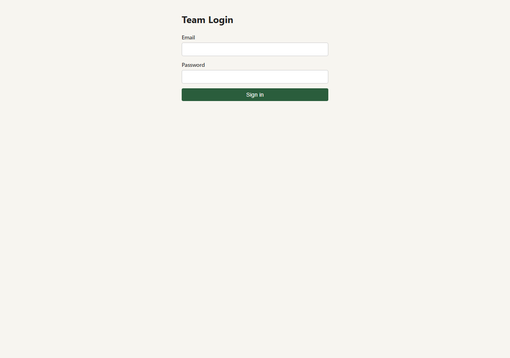

If your account has two-factor authentication enabled, you'll be prompted
for a 6-digit code from your authenticator app after your password. If an
admin has *required* MFA on your account but you haven't set it up yet,
you'll be walked through enrollment (scan a QR code, confirm a code)
before you can do anything else.

## Understanding your role

Every user has one of three roles:

| Role | Can change |
|---|---|
| `viewer` | Nothing. Read-only. |
| `editor` | Create, edit, and archive/unarchive partners; add support entries, one-time needs, trips, and prayer requests; upload newsletters and documents. Can't delete anything, manage users, or change Church Settings. |
| `admin` | Everything above, plus delete records, manage users, and edit Church Settings. |

**Roles control what you can change, not what you can see.** Every account,
including a `viewer`, can read every partner's full record — home address
and GPS coordinates, family members' phone numbers and birthdays, emergency
contacts, and the real name and photo of partners marked
restricted-access. There is no reduced view for lower roles.

That's a deliberate design choice, not an oversight: this is a small
internal tool for one church, and splitting what staff can see would make
the prayer list less useful without meaningfully protecting anything, since
anyone who needs an account needs the information. But it does mean **an
account is the whole permission** — treat handing one out the same way you'd
treat handing someone the filing cabinet key. If you only want someone to
see what's public, send them the public site; they don't need an account at
all.

If something you expect to see isn't there (a nav link, a button), it's
almost always a role thing, not a bug — check with whoever manages users
at your church.

## Dashboard overview

The sidebar (and the Home page's card grid, which mirrors it) lists:
**Home**, **Partners** (or your church's custom term, e.g. "Go Team
Partners," if enabled in Branding), **Monthly Support**, **One-Time
Needs**, **Prayer Requests**, **Trip History**, **Trip Opportunities**,
**Newsletters**, **Documents**, **Print Booklet**, **Reports** — visible
to everyone, each one only if its
[feature toggle](ADMIN_GUIDE.md#feature-toggles) is on. **Site
Administration**, an expandable group at the bottom of the
sidebar, appears only for admins and holds **Manage Users**, **Branding**,
**Enabled Features**, **About Church**, and **GroupMe** — see
[Church Settings](#church-settings-admin-only) and
[GroupMe notifications](#groupme-notifications-admin-only) below. The
footer has **My Account**, a link back to the public site, and **Log
out**.

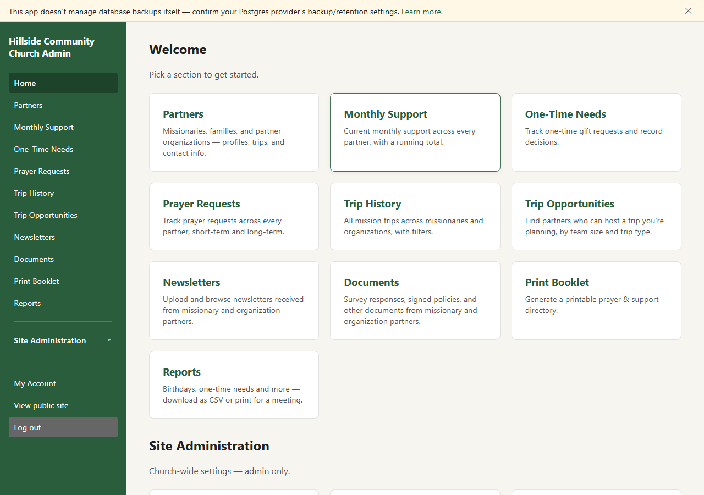

Missionaries and organizations share one combined **Partners** list —
there's no separate nav entry for each; you pick which kind to add from
the list page itself.

## Managing partners (missionaries & organizations)

### The Partners list

Filter by Type (missionary/organization), Public (yes/no), Restricted
(yes/no), Continent, and Country — the continent/country dropdowns only
show what's actually represented in your data, and picking a continent
narrows the country list to match. There's also a free-text search box
that matches across name, field/region, focus area, short overview, and
country — it's diacritic-insensitive (a search for "sao tome" matches
"São Tomé") and multi-word (typing two words requires both to match
somewhere, not as one exact phrase). A "Show archived" checkbox reveals
archived records, and **Reset filters** clears everything back to
defaults.

Click **+ Add Missionary** or **+ Add Organization** to create one; click
any row to view that partner's detail page.

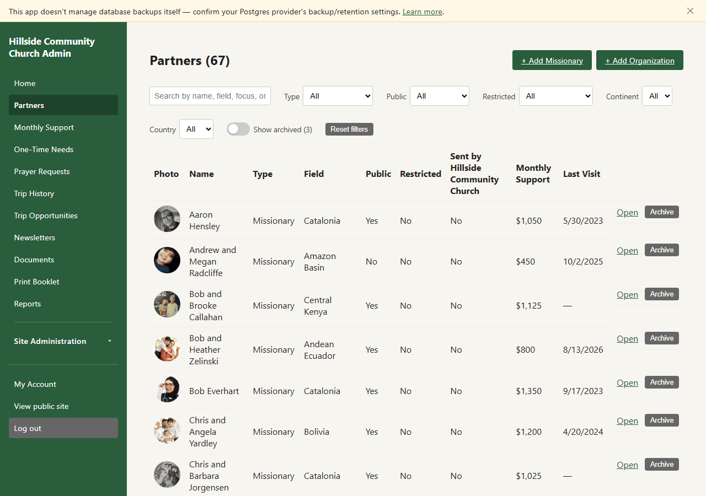

### Creating a missionary

**+ Add Missionary** opens a short form asking just for what can't be
filled in later from the record itself: Display Name (required),
Country, Field/Region Display Name, a Short Overview, and four
checkboxes — **Safe to contact**, **Show on public site** (`isPublic`),
**Restricted-access location** (`isRestricted` — see
[Understanding restricted-access partners](#understanding-restricted-access-partners)
below before checking this), and **Sent by {your church}**. **Create
Partner** saves it and takes you straight to its detail page, where
everything else — photo, financial support, ministry overview, serving
location, family, trip history, and the rest — gets filled in section by
section. See [Editing a partner](#editing-a-partner) below.

### Creating an organization

**+ Add Organization** is the same short form, with **Organization
Name** and an **Organization Type** dropdown (Local/National) in place
of Display Name, and no "Safe to contact" or "Sent by" checkboxes —
those are person-specific.

### Editing a partner

There's no single "edit form" holding the whole record — each section on
a partner's **detail page** edits in place. Click that section's own
**Edit**, the fields become editable right there, **Save** (or
**Cancel**) without leaving the page. Every section saves only its own
fields, so fixing a typo in the overview never touches anything else on
the record.

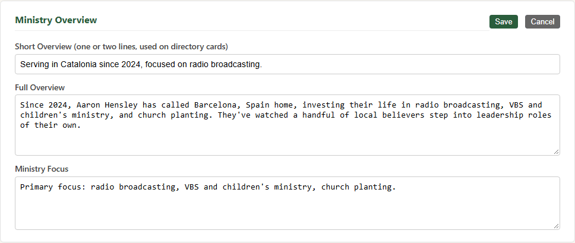

The sections, and what each holds:

- **Photo** (missionary) / **Logo** (organization) — upload (JPEG/PNG/
  WebP) with a live preview and a Received Date. Uploading here always
  adds a new photo rather than replacing the current one — the previous
  photo becomes history instead of being deleted. Only the current photo
  (whichever has the latest Received Date) shows on the public site;
  view the full history or delete an old photo from
  [Photo history](#photo-history) below.
- **Core Info** — Display Name, Field/Region, Supporting Since,
  Preferred Contact Method (missionary), or Organization Name/Type
  (organization), plus a missionary-only **"Sent by {your church}"**
  checkbox — see the **Sending Church** bullet below for what checking
  it does.
- **Financial Support** — repeatable Monthly Amount / Effective Date /
  Notes rows. The most recent effective date is what counts as the
  current amount everywhere else in the app. Never shown publicly.
- **One-Time Needs** — repeatable Description / Requested Amount /
  Request Date / Approved Amount / Approved Date / Notes rows (you can
  also manage these from the dedicated **One-Time Needs** page).
- **Ministry Overview** (missionary) / **Focus Area** (organization) —
  Short Overview (used on directory cards), Full Overview, and Ministry
  Focus.
- **Serving Location** — a full address (country is a suggest-as-you-type
  field, not a hard dropdown — pick a suggestion or type your own if it's
  not in the list), plus GPS coordinates (leave blank to auto-geocode from
  the address on save, or enter manually) and a Country Code, which drives
  a live Joshua Project stats lookup on the form itself. That code
  auto-fills from the address's country the first time it resolves to a
  recognized name, but only while the field is still blank — enter it
  yourself and it's never overwritten. It's a FIPS code specifically,
  which for many countries differs from the more familiar ISO code (e.g.
  the Philippines is `RP`, not `PH`) — that mismatch is exactly why the
  auto-fill exists. This exact address is never shown publicly — only the
  GPS pin is, and only at all if `isPublic` is checked.
- **Mailing & Contact Address** — a separate address, with "Receives mail
  here" / "Receives packages here" checkboxes.
- **Contact Info** (organization only) — name, phone, email, website,
  support link, newsletter signup, and social media, all in one section
  (split across Core Info and Links for a missionary instead).
- **Adults** (missionary only) — Wedding Anniversary, then one row per
  adult in the household (Name, Birthday, two phone numbers, Email).
- **Children** (missionary only) — Name + Birthday per child.
- **Emergency Contact** (missionary only) — Name, Phone, Email.
- **Languages Spoken** (missionary only) — a free-text tag list.
- **Trip Capacity** — Team Size Min/Max, Trip Types Supported (pick from
  presets or type your own), season/duration notes, lodging/logistics
  notes. This is what powers the **Trip Opportunities** capacity search.
- **Trip History** — past trips, each with dates, type, description,
  notes, and a nested list of participants (Name, Role, Phone, Email,
  "Trip Leader" checkbox).
- **Furlough** — Start/End Date (leave End Date blank for an ongoing
  furlough) and Notes.
- **Church Visits** — Visit Date + Notes; the most recent becomes "last
  visit" everywhere it's shown.
- **Sending Church** (missionary only) — name, contact, phone, website,
  mailing address. Checking **Core Info**'s "Sent by {your church}"
  checkbox auto-fills whichever of these fields are still blank straight
  from Church Settings, without overwriting anything you've already
  typed, whether you check it when first creating the partner or later.
  Unchecking it never deletes data that's already there — it's a
  one-way convenience fill, not an ongoing sync, so a later change to
  Church Settings doesn't retroactively update an already-filled field.
- **Sending Org** (missionary only) — same shape as Sending Church, no
  auto-fill checkbox.
- **Links & Social Media** (missionary) / folded into **Contact Info**
  (organization) — Website, Support Link, Newsletter Signup, Facebook,
  Twitter, Instagram, LinkedIn.

Blank repeatable rows (an empty adult, an empty trip, etc.) are silently
dropped when you save — you don't need to manually remove unused rows.

### The partner detail page

Shows every section described in [Editing a partner](#editing-a-partner)
above — sections with no data are hidden entirely rather than shown
empty. Status pills under Core Info summarize the flags at a glance
(contact-safe, public/not, restricted, sent-by-us, on-furlough,
archived). **Back to list** returns you to Partners. This page *is*
where every edit happens — each section's own **Edit** button, not a
separate form — including newsletters, documents, and photos (see
[Newsletters](#newsletters), [Documents](#documents), and
[Photo history](#photo-history) below).

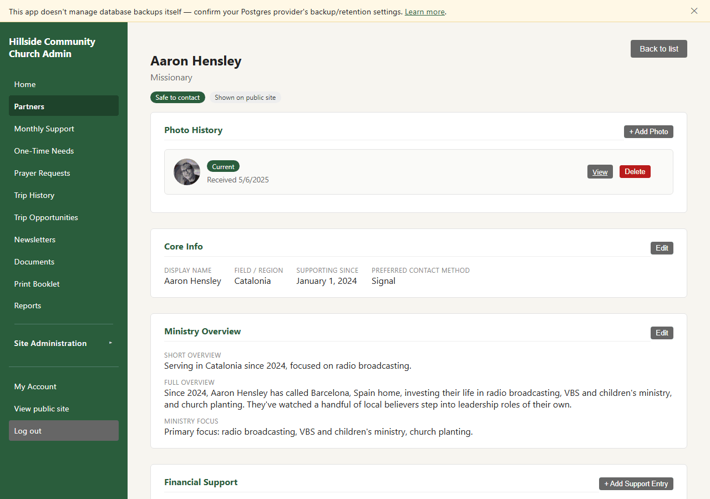

### Photo history

Every photo/logo ever uploaded is kept, not just the current one — the
detail page's **Photo History** section lists them all, newest received
first, each with its Received Date and a **Current** badge on the one
actually shown on the public site (whichever has the latest Received
Date — not necessarily the most recently uploaded, so backfilling an
older photo won't demote a more recent one still to come). **+ Add
Photo** here works the same as uploading from the Edit form. **Delete**
removes one permanently, including the current one — if you delete the
current photo, whichever remains with the next-latest Received Date
automatically becomes current. There's no "restore" — re-upload a
deleted photo if you need it back.

### Archiving vs. deleting

**Archive** and **Delete** are row actions on the **Partners list**, not
on the partner's own detail page. **Archive** removes a partner from the
public site and zeros out their monthly support total (by adding a new
$0 entry, not by touching existing history), while keeping their full
history — reversible any time via **Unarchive**. Unarchiving only clears
the archived flag, though: it does *not* automatically turn "Show on
public site" back on or add a new support entry — those are deliberate
decisions to make again once someone's actually back, from
[Editing a partner](#editing-a-partner). **Delete** is only available on
an already-archived record, is permanent, and requires typing "confirm"
to proceed. When in doubt, archive.

### Understanding restricted-access partners

Two checkboxes on every missionary/organization control what the public
site can see, independently of each other:
- **Show on public site** (`isPublic`) — whether the partner appears on
  the public site at all. Leave it unchecked for internal-only records
  (e.g. someone your church supports but doesn't publicize).
- **Restricted-access location** (`isRestricted`) — only relevant if
  `isPublic` is also checked. Automatically, on the public site only:
  reduces the missionary's name to initials (an organization's name stays
  visible — it's an institution, not a person), replaces their real photo
  with a generic silhouette icon (a plain shape — single, couple, or
  family, matching their actual household — never a real photo of any
  kind, generic or otherwise), drops the precise GPS pin down to a
  country-level approximation (or no pin at all, if their country isn't
  recognized — see
  [ADMIN_GUIDE.md § Troubleshooting](ADMIN_GUIDE.md#troubleshooting)),
  replaces the overview with a generic security-conscious blurb, and
  strips all contact info, sending church/org, children's
  names/birthdays, and prayer requests entirely — even a strategic
  request marked Show on public profile never appears for a restricted
  partner.

Neither flag affects what you see in the admin dashboard — the masking
only ever applies to the public site. The masking rules themselves live
in one place in the code (`backend/src/utils/maskData.js`) — worth a
periodic team review, since you know which details are genuinely safe to
show for your specific restricted-access partners.

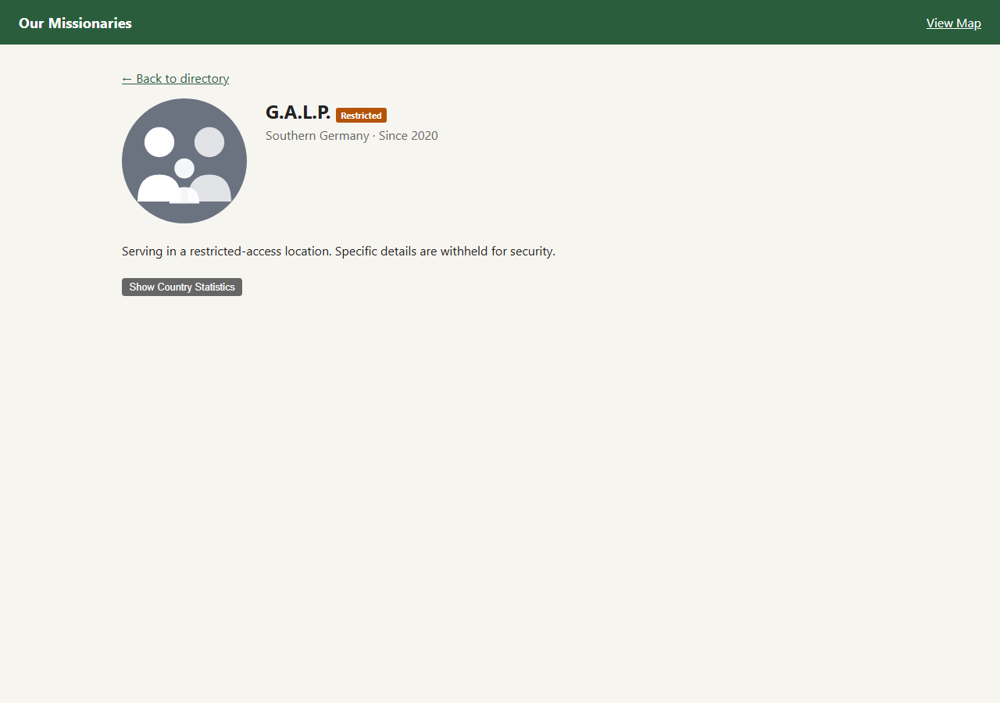

## Financial support & one-time needs

**Monthly Support** shows every partner with at least one support entry,
their current monthly amount, and a running total — archived partners
excluded unless you check "Include archived." Click a row to jump to that
partner. **+ Add Support Entry** logs a new amount against any partner
(the newest effective date is always what counts as "current"); each
row's **History** button expands to every entry on file for that partner,
with a **Delete** to remove one entered by mistake. There's deliberately
no in-place edit here — a support entry is a point-in-time record, like a
line in a ledger, so correcting one means deleting it and adding a new
entry rather than rewriting history.

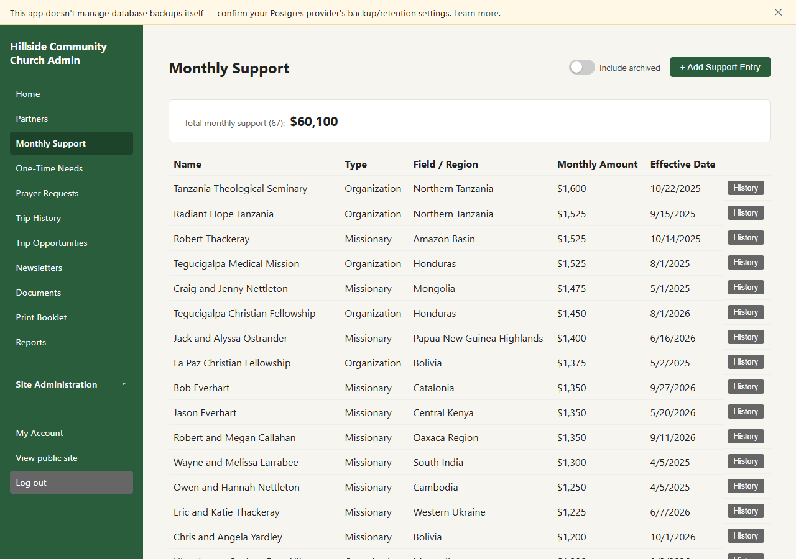

**One-Time Needs** lists every recorded need across all partners, with a
status pill (Pending Decision / Fully Funded / Partially Funded /
Declined) computed from the approved vs. requested amount. **+ Add Need**
adds one without leaving the page; an undecided need gets a **Record
Decision** button to fill in the approved amount/date once your church
has made a call.

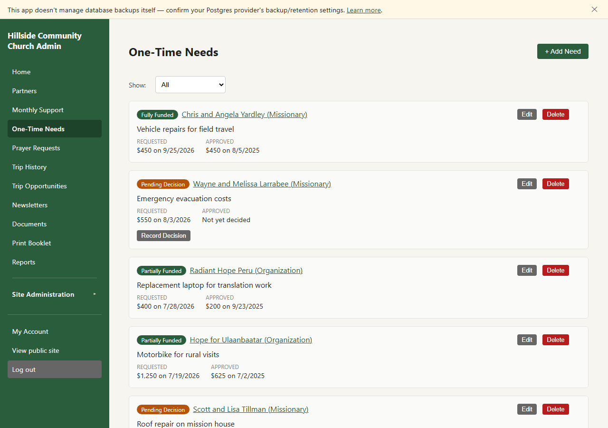

## Trip history & trip opportunities

These are two different things:
- **Trip History** is a filterable log of trips that already happened,
  flattened across every partner — filter by type, year, team size. **+
  Add Trip** logs one (pick the partner, dates, trip type, description,
  and participants) without leaving the page; each row has its own
  **Edit** (everything except which partner it's under — delete and
  re-add to move a trip to a different partner) and **Delete**. Trips can
  still be added/edited from a partner's own Edit form too, same as
  before — both write to the same records.
- **Trip Opportunities** is a forward-looking capacity search — "who
  could host a trip like this" — filtering by team size, trip type,
  region, and how recently a team last visited, reading the same Trip
  Capacity fields set on each partner's form.

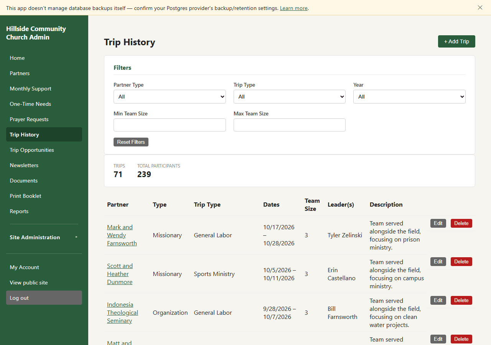

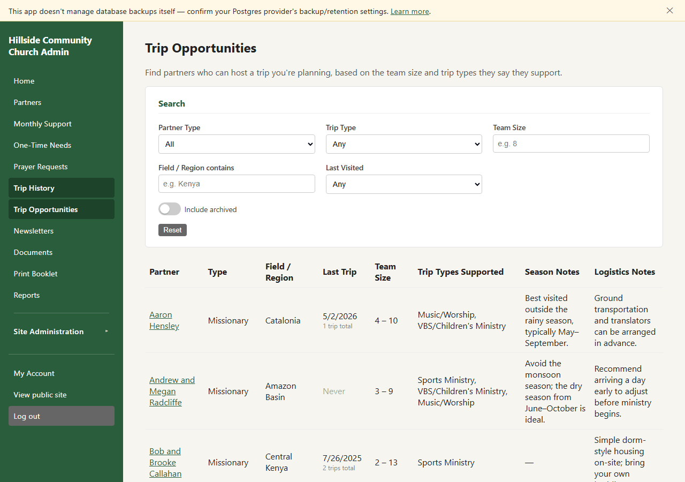

## Newsletters

Upload from the central **Newsletters** page (**+ Upload Newsletter**:
pick the partner, choose a file — PDF, `.eml`, JPEG, or PNG — optional
title/notes) or directly from that partner's detail page, which embeds
the same upload/view/delete UI. **View** opens the file in a new tab;
**Edit** lets you fix everything but the uploaded file itself — title,
received date, notes, and (from the central page only) which partner
it's filed under; **Delete** removes it permanently. Newsletters are
always private — never shown on the public site, regardless of the
partner's `isPublic` flag.

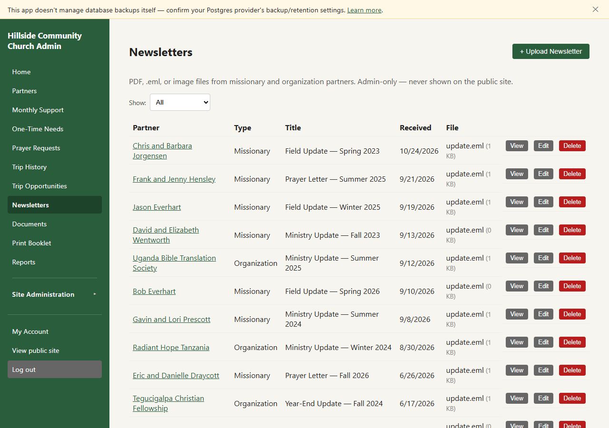

## Documents

A separate, more general place to keep other files from a partner —
survey responses, a returned signed policy acknowledgment, Word/Excel/PDF
documents, or an email you want kept on file long-term — anything that
isn't a newsletter update. Same private, admin-only visibility as
Newsletters; the difference is what each is *for*, not who can see it.

Upload from the central **Documents** page (**+ Upload Document**: pick
the partner, choose a file — PDF, Word `.doc`/`.docx`, Excel `.xls`/
`.xlsx`, `.eml`, JPEG, or PNG — pick a **Category**, optional title/notes)
or directly from that partner's detail page, which embeds the same
upload/view/delete UI. Every document needs a category:

| Category | For |
|---|---|
| Survey Response | A completed survey or check-in questionnaire sent back by the partner. |
| Signed Policy | A policy acknowledgment (child protection, code of conduct, etc.) signed and returned. |
| Email Communication | An email exchange worth keeping on file long-term. |
| Office Document | A Word/Excel/PDF document that doesn't fit the other categories. |
| Other | Anything else — pick this and type your own label (e.g. "Background Check"). |

The central **Documents** page can filter by category and by
missionary/organization, so you can, for example, pull up every signed
policy on file across all partners at once. **View** opens the file in a
new tab; **Edit** lets you fix everything but the uploaded file itself —
category, title, received date, notes, and (from the central page only)
which partner it's filed under; **Delete** removes it permanently.

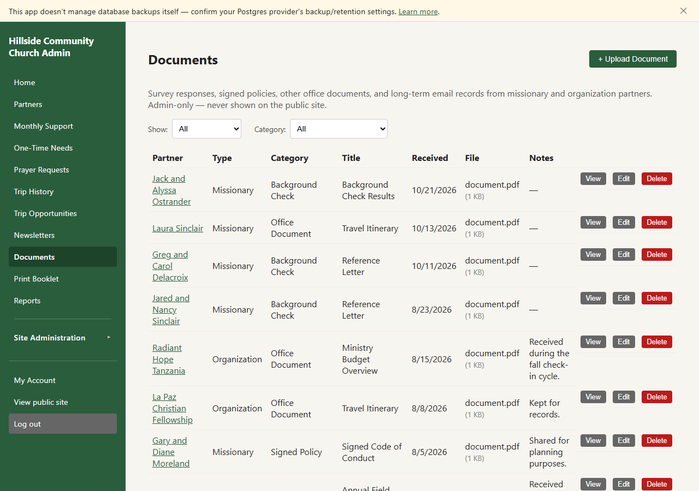

## Prayer Requests

Meant as a long-term record of what's been prayed for and how it was
answered — not a checklist. Add one from a partner's detail page or the
central **Prayer Requests** page (pick the partner, category, and the
request itself).

- **Category** is **Strategic** (tied to the ministry's long-term vision
  or calling — church planting, discipleship, language study, funding —
  can optionally be shown on that partner's public profile via **Show on
  public profile**) or **Situational** (whatever came up — health,
  travel, family needs, paperwork; admin-only, never shown publicly
  regardless of any setting).
- A strategic request marked **Show on public profile** can also be
  checked **Include in printed booklet** — a separate setting, since a
  partner can build up more public strategic requests over time than
  would ever fit on a printed page. Only requests checked both ways ever
  appear in the booklet, and even then only up to the per-partner cap set
  on the [Booklet](#booklet) page (a handful, most recent first) — the
  rest still show on the public profile, just not in print. See
  [Printable partner booklet](#printable-partner-booklet) below.
- An open request just sits there — there's no "pending" or "unanswered"
  label anywhere in the app. Most requests, especially strategic ones,
  simply don't have a resolution yet, and that's normal, not a gap to
  flag. If you don't intend to follow up on a specific request for a
  formal answer (many situational ones), check **Not tracking this one
  for a specific answer** when adding it.
- When a request *is* answered, click **Record Answer** on it — the date
  and an optional note on how it was answered (shown as a quiet "✓
  Answered" line, never a colored badge). This is the part worth keeping
  long-term: a public strategic request's answer note shows on that
  partner's public profile and in the booklet too, right alongside the
  request itself — a real, growing record of how prayers actually get
  answered over time, not just a log of what's currently outstanding.

The central **Prayer Requests** page lists every request across every
partner, filterable by category, with a running count of how many have
been answered so far.

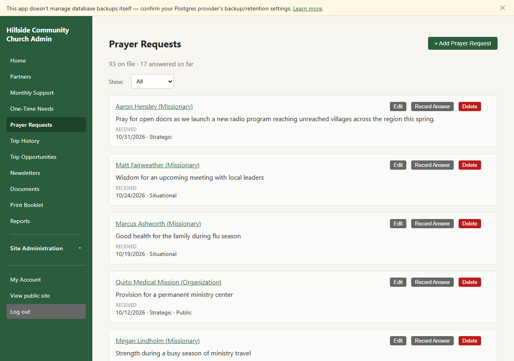

## Reports

Read-only views over data already in the tracker, for anyone who needs
numbers rather than a record-by-record browse. Pick a report, set its
filters, and click **Run report**; **Reset Filters** clears everything
back to that report's defaults. Every report's results can be exported
as **Download CSV** (a spreadsheet, same rows and columns as the screen)
or **Print** (a clean paginated layout for handing to a meeting).

| Report | Shows |
|---|---|
| Upcoming Birthdays | Adults and children with a birthday, with the partner they belong to. Defaults to a full-year view (every month, in order); switch its **View** filter to **One month** for a single calendar month instead. No feature toggle gates this one — it's always available. |
| Monthly Support | Every partner's current monthly support amount, as of its most recent entry — the same number [Monthly Support](#financial-support--one-time-needs) shows. |
| One-Time Needs | One-time gift requests in a date range, with what was requested, what was approved, and what's still pending a decision. |
| Prayer Requests | Prayer requests across every partner, filterable by category, status, and date range. |
| Trip History | Mission trips across every missionary and organization, with dates, type, and team size — the same filters as [Trip History](#trip-history--trip-opportunities)'s own page. |
| Furlough | Missionaries currently on furlough or with an upcoming furlough on file, with start/end dates and notes. No feature toggle gates this one — furlough tracking is always available. |

A report tied to a feature that's turned off (see
[ADMIN_GUIDE.md § Feature toggles](ADMIN_GUIDE.md#feature-toggles))
simply doesn't appear in the picker — Upcoming Birthdays and Furlough are
the two exceptions, since neither has a feature of its own to tie to.

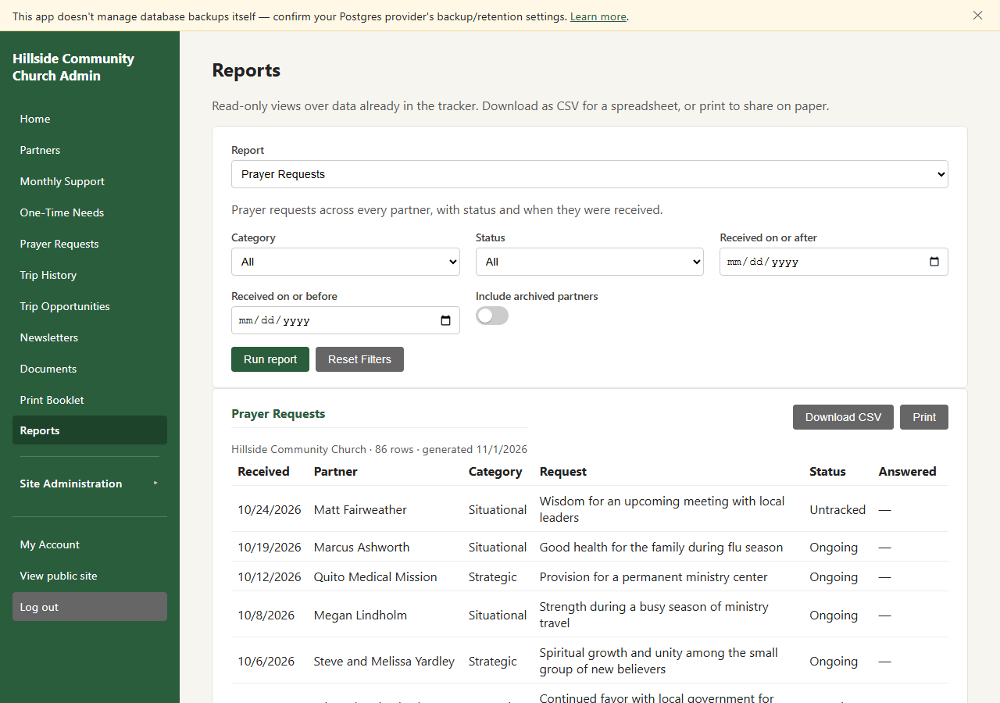

## Printable partner booklet

**Print Booklet** builds a print-formatted directory: pick a **Look &
Feel** template — Classic (warm accent-colored circles and a tinted
callout), Modern (clean, no decorative shapes, bold rules), Traditional
(a bordered page frame, small centered portrait, serif type throughout),
Keepsake (a polaroid-framed, slightly tilted photo, a handwritten-note
callout), Portfolio (a large photo-led layout, high-contrast dark
header), or Friendly (a bold color-block header, a large circular photo,
rounded pill-style info rows) — choose who's included (archived,
restricted-access, organizations), and what shows on each page (photo,
overview, location, address, family info, sending church/org, and an
optional facing **Notes & Prayer Page** with ruled lines for the
reader's own handwritten notes). Turning on **Prayer Requests** also
turns on, and locks on, that facing page — a partner's public
[prayer requests](#prayer-requests) marked **Include in printed
booklet** print at the top of it, not on the main page itself (an
"answered" one includes its note, an open one doesn't call out its
status at all, same as everywhere else in the app), with the ruled
lines below them; the Notes & Prayer Page can still be turned on by
itself, with no prayer requests, for a facing page that's just that
partner's name and blank ruled lines. With Prayer Requests on, a
**Max prayer requests per partner** field caps how many print for any
one partner (most recent first) so a partner with a long history
doesn't crowd out the rest of their page. Set a cover title/subtitle.
Every booklet also
ends with a closing back cover — your church's logo and name (from
[Church Settings](#church-settings-admin-only)) plus your About Text or
Public Tagline as a closing message, or a generic thank-you if neither is
set. **Update Preview** re-renders on the page — automatically when you
switch templates, but not on every checkbox (re-pagination is expensive)
— and **Open in New Tab to Print** builds a clean, paginated document
ready for your browser's print dialog — useful for printing a physical
prayer/support directory for your congregation.

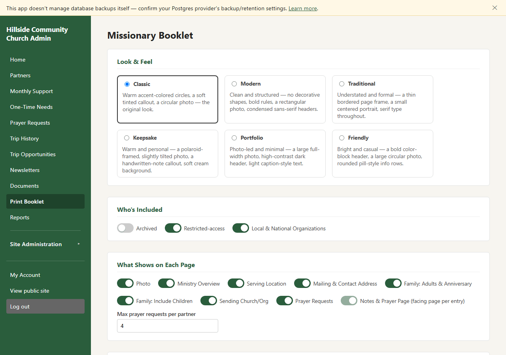

## Church Settings (Admin only)

One record controls the whole instance's branding, split across two pages
under Site Administration — changes on either take effect immediately,
everywhere, with no code changes needed:

- **About Church** — Church Info: name, phone, contact name/email,
  website, and address. This is also what auto-fills "Sent by our church"
  on the missionary form.
- **Branding** — Public Site (tagline, about text, brand color), Logo,
  and Partner Terminology (swap "Missionary" for whatever your church
  calls them, and optionally use that term in the admin nav too).

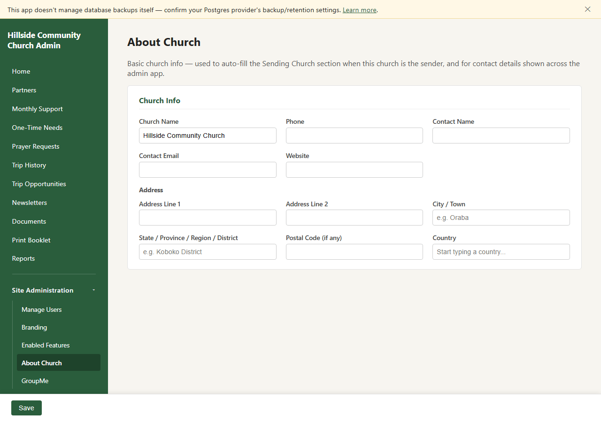

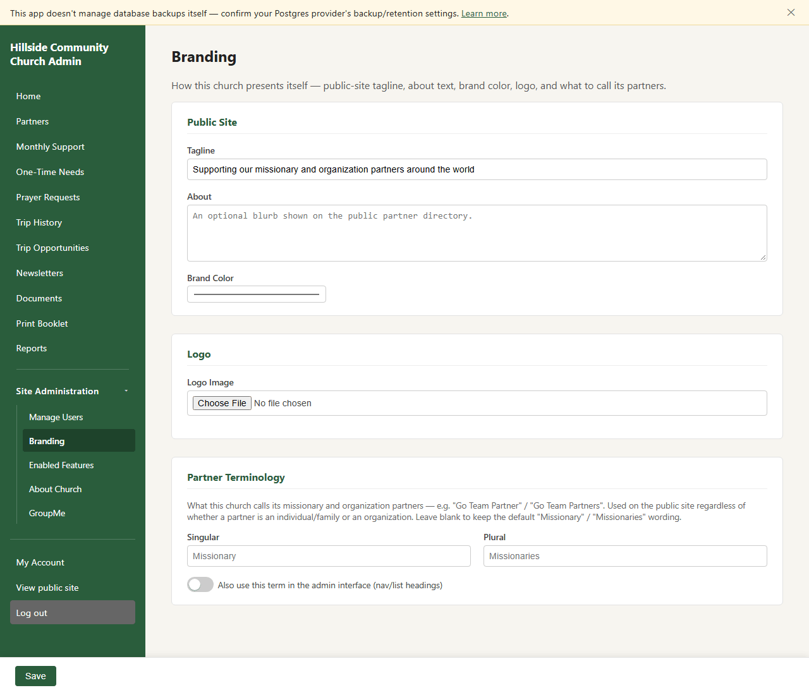

## GroupMe notifications (Admin only)

Posts new prayer requests to a GroupMe group as they're added, so a
prayer team sees them the moment they're added without checking the
admin dashboard. Off by default — turn it on in
[Enabled Features](ADMIN_GUIDE.md#feature-toggles) once it's set up here.

Setup, on the **GroupMe** page under Site Administration, is three steps,
each building on the last:

1. **Access Token** — paste a personal access token from
   [dev.groupme.com](https://dev.groupme.com). Messages post under that
   account's own GroupMe identity, not a bot — write-only once saved,
   same as a password field; leave it blank on a later save to keep the
   existing one.
2. **Group** — click **Load My Groups** to pull the token's actual
   GroupMe groups, pick one, **Use This Group**.
3. **Prayer Requests Topic** — click **Load Topics** to pull that group's
   real Topics, pick one, **Use This Topic**. Until a topic is picked,
   prayer requests post to the group's main conversation instead.

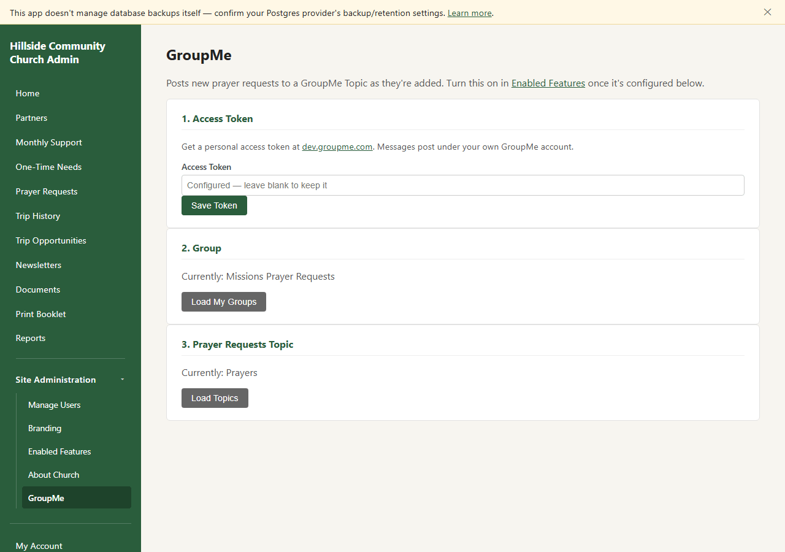

If GroupMe itself is unreachable or rejects a post, the prayer request
still saves normally — the notification is best-effort and never blocks
your own work.

Once it's working, a new prayer request shows up in the configured Topic
within the GroupMe app itself, same as any other message:

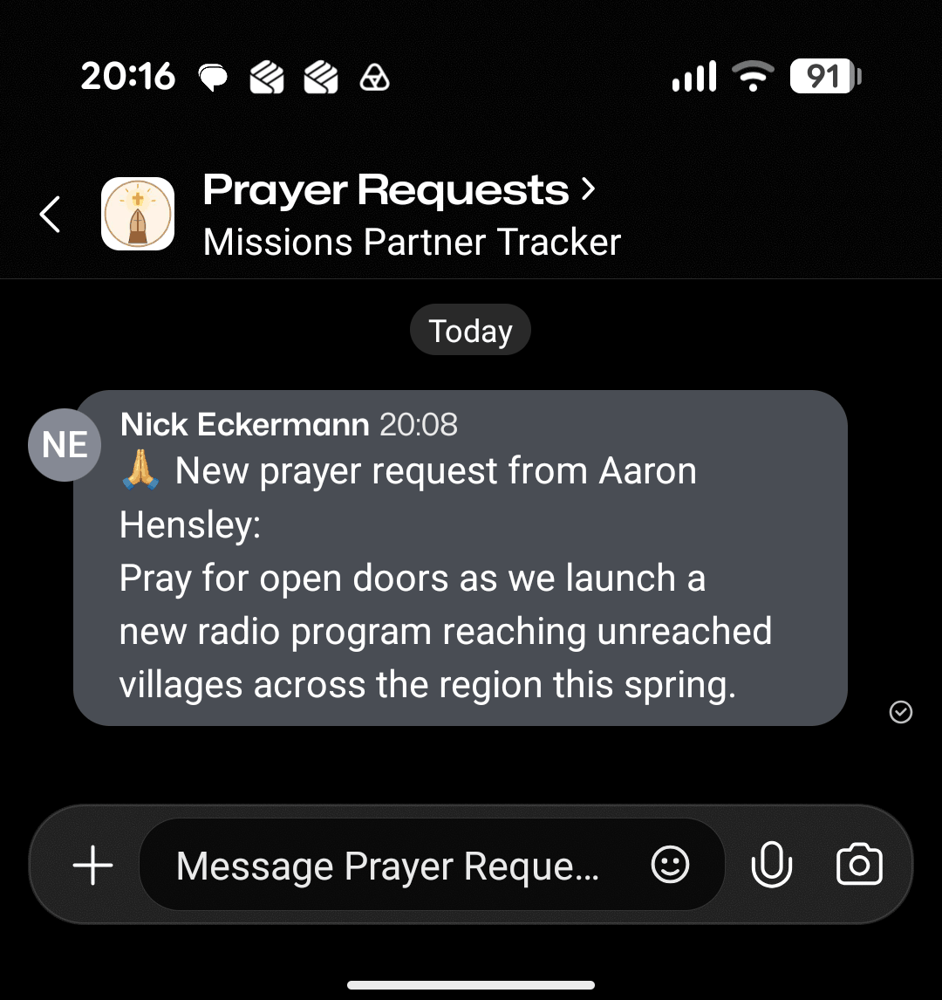

## User management (Admin only)

**Manage Users** lists everyone with access — email, role, active status,
MFA status, last login. **+ Add User** creates one: email, role, and a
password (every account is email + password, per
[Logging in](#logging-in) above). Editing lets you change role,
deactivate, force MFA enrollment, or reset a password. **Reset MFA**
clears a locked-out user's two-factor setup so they can log back in with
just their password and re-enroll. You can't delete your own account,
and the app won't let you demote, deactivate, or delete the last active
admin — there's always at least one way back in.

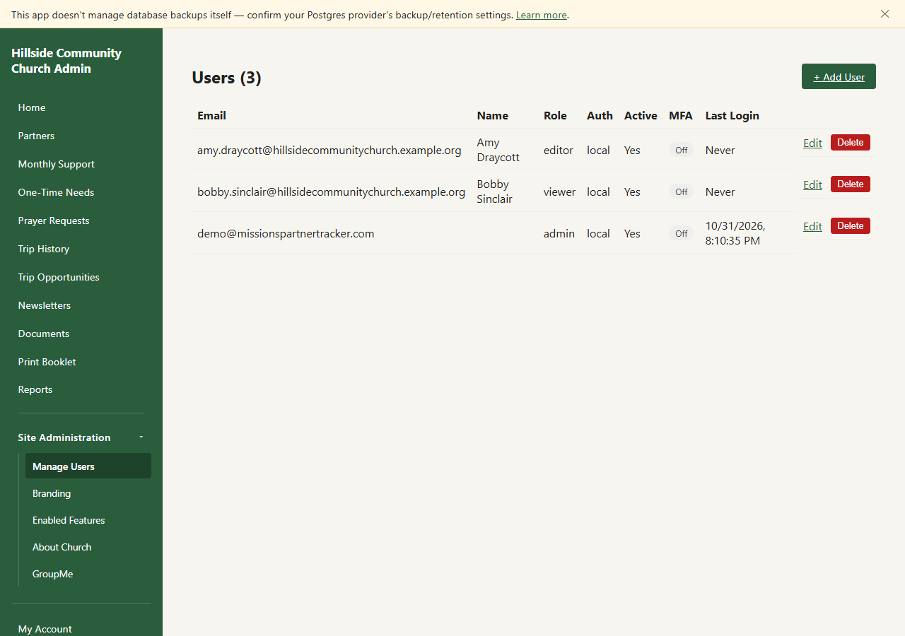

## Your account settings

**My Account** is where you manage your own login, regardless of role.
You can change your password (current password required) and
enable/disable two-factor authentication — enabling walks you through
scanning a QR code and confirming a code; disabling requires your current
password.

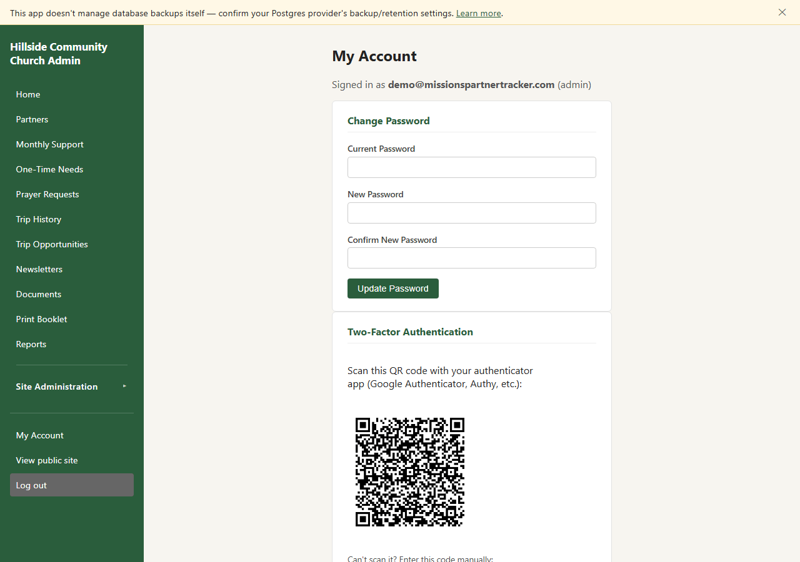

## The public site

Worth understanding what visitors actually see, since it's driven
entirely by what you check in the admin dashboard:
- **Partner Directory** (`/`) — a searchable, filterable grid (same
  continent/country/type filters as the admin Partners list) of everyone
  with `isPublic` checked. Search also matches the same way (diacritic-
  insensitive, multi-word) across name, field/region, focus area, short
  overview, country, and — unlike the admin Partners list — sending
  church/org name.

  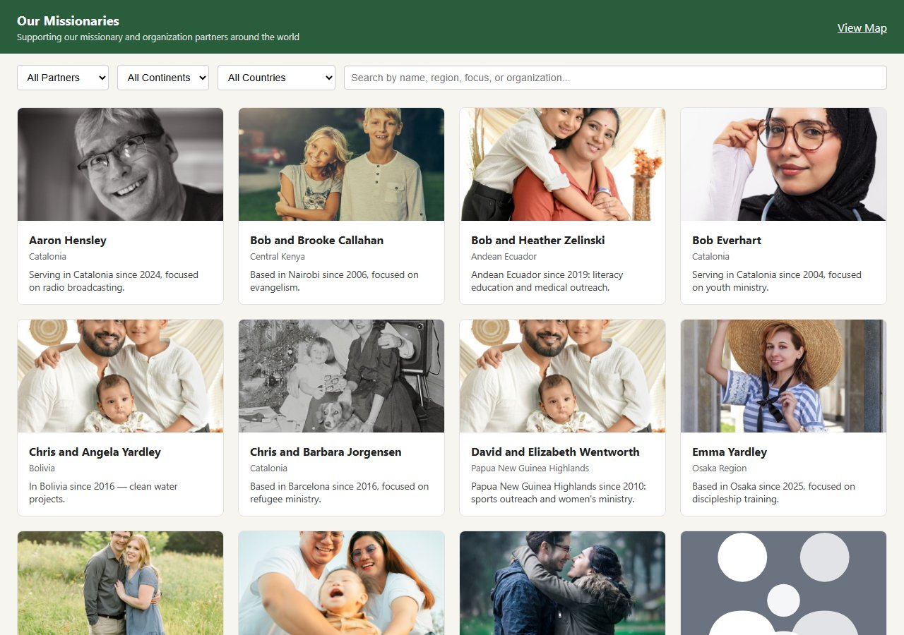
- **Map** (`/map`) — the same partners plotted on an interactive Leaflet
  map. Restricted partners show at country-level precision only, if they
  show at all — see
  [Understanding restricted-access partners](#understanding-restricted-access-partners).
  Organizations aren't part of the auto-tour cycle described below, but
  their pins are still clickable any time.

  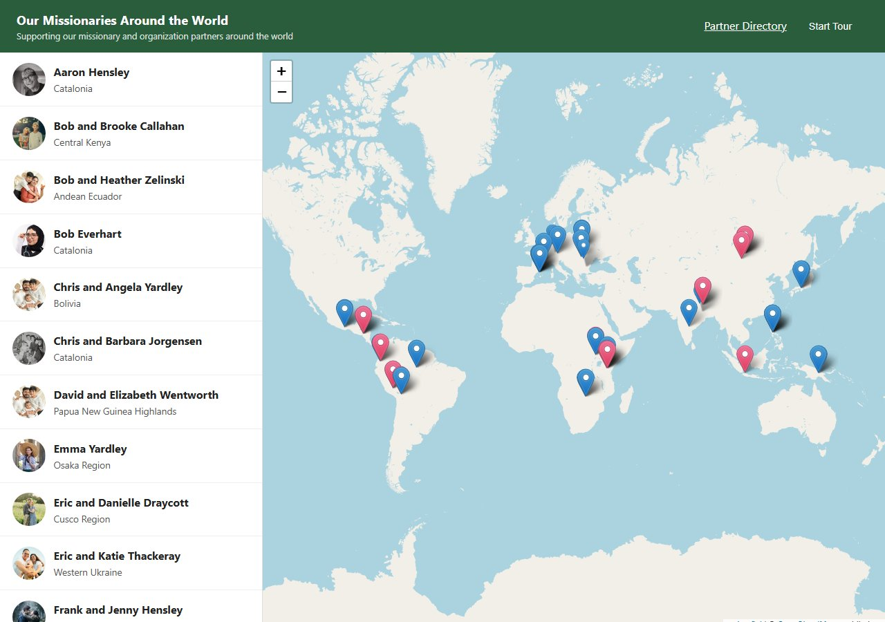
- **Partner detail page** — the fuller write-up linked from both the
  directory and the map, masked the same way for restricted partners. A
  **Show Country Statistics** button (visible whenever the partner has a
  Country Code set) fetches live population, primary religion, percent
  evangelical, and how reached that country is, straight from the
  [Joshua Project](https://joshuaproject.net/) — the same lookup the
  [Serving Location](#editing-a-partner) field offers on the
  admin side, here for visitors.

  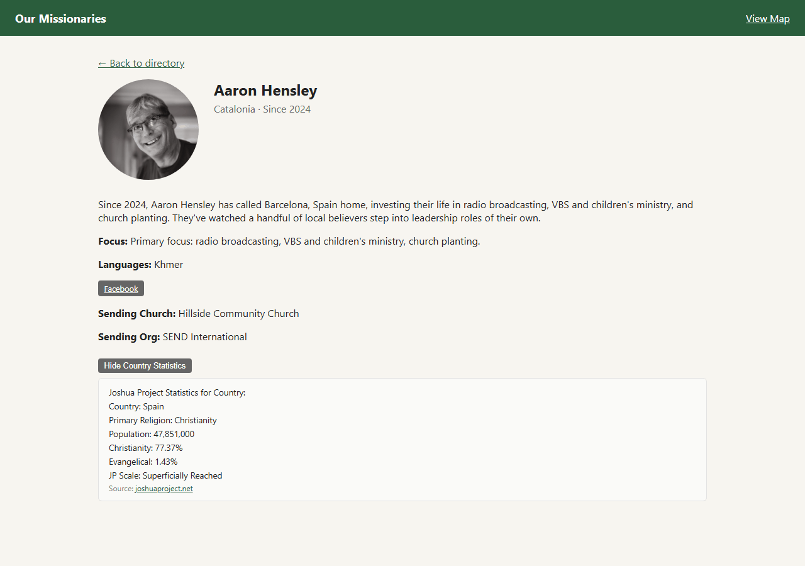

### The public map's auto-tour

The map can automatically cycle through missionary pins, flying to each
one and opening its popup — useful for an unattended display (e.g. a
lobby kiosk) as well as regular visitors:
- **Manual**: the "Start Tour" / "Stop Tour" button in the header toggles
  it. Clicking any pin or list card stops the tour and holds on that pin.
- **Auto-start via URL**: append `?tour=1` to the map's URL to start the
  tour immediately on load — a kiosk display just needs to open that URL
  once.
- **Speed**: `?tourSeconds=N` sets how long each pin stays in view before
  advancing (this alone also implies `?tour=1`). Defaults to 30 seconds.
- The tour always jumps to the first pin immediately when it (re)starts —
  it doesn't wait a full `tourSeconds` before the map first moves, even if
  a different pin was already active from earlier browsing.
- Only missionaries with a resolvable pin are included in the cycle — see
  [ADMIN_GUIDE.md § Troubleshooting](ADMIN_GUIDE.md#troubleshooting) if a
  restricted partner isn't showing up.

Nothing on the public site is editable — it's a read-only mirror of
whatever's marked public in the admin dashboard.
